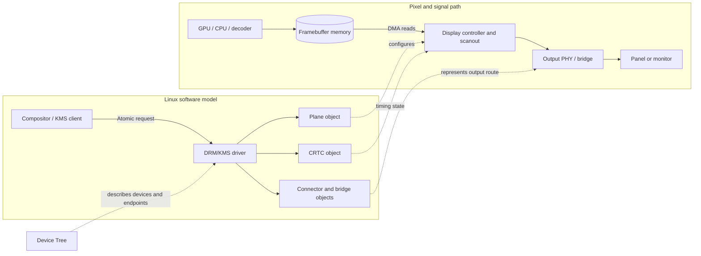
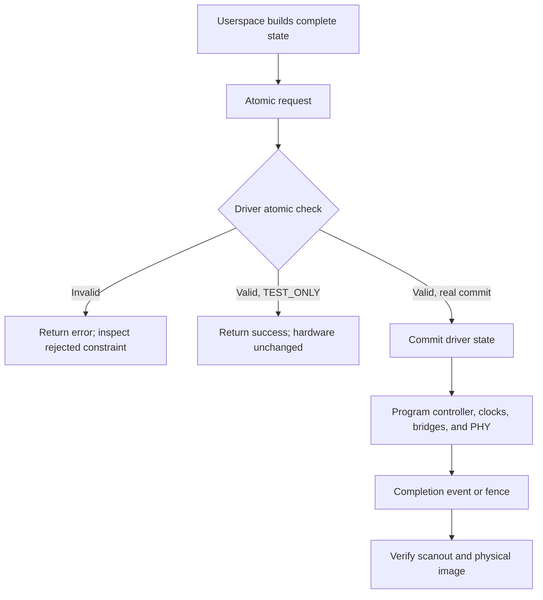

# Linux Display Drivers, From Pixel to Panel

## A Practical Guide to DRM/KMS, Device Tree, Display Links, and Debugging

**Avinash Pal**

---

## Copyright and Disclaimer

Copyright (c) 2026 Avinash Pal. All rights reserved.

This manuscript is an educational work. Linux kernel interfaces, driver behavior, hardware documentation, and supported configurations change over time. Code and procedures must be checked against the kernel tree, binding schemas, and hardware documentation for the system being used. Nothing in this book replaces a board vendor's specifications, electrical limits, or safety procedures.

Product and company names belong to their respective owners. Their use identifies technologies discussed in the text and does not imply endorsement. Kernel documentation and source code cited in this book remain the work of their respective contributors and are governed by their own licenses.

## About the Author

Avinash Pal writes for engineers who want to understand display systems from both sides of the boundary: the software objects Linux exposes and the signals the hardware must produce. This book takes a practical, evidence-first approach. It treats a black screen not as a mysterious symptom, but as a chain of testable stages that can be inspected one by one.

## About the Book

A Linux display is a system, not a single driver. Pixels begin in memory, pass through a display controller, and reach a panel or monitor over a physical interface. Device Tree describes how many of those components are connected. DRM and Kernel Mode Setting (KMS) represent the pipeline to the kernel and userspace. DMA, clocks, interrupts, power sequencing, and link protocols determine whether the picture actually appears.

This book follows that path in the order an engineer needs to understand it. It starts with the complete pipeline, builds a precise vocabulary for its components, then studies memory, atomic configuration, and the major display links. The final chapters turn that knowledge into a repeatable bring-up and debugging method.

Daily-life comparisons are used as memory aids: a framebuffer can be thought of as a prepared page, and a display pipeline as a timed delivery route. The comparison is never a substitute for the engineering model. Each analogy is followed by the actual Linux or hardware concept, including where the analogy stops being accurate.

The scope is the Linux DRM/KMS display stack on embedded and general-purpose systems. The details vary among SoCs, panels, bridges, and kernel releases; the method of tracing ownership and collecting evidence is intended to transfer between them.

## Why Display Drivers Matter

A display driver sits where software state meets visible hardware behavior. A compositor can render a perfect image and still produce a black screen if the display controller is not scanning the buffer, a bridge is not powered, or a link has not trained. Conversely, a panel can be electrically alive while the kernel has no correct description of its timing or connection.

Display problems also cross subsystem boundaries. One failure may involve a Device Tree endpoint, a clock parent, an IOMMU mapping, a DRM plane constraint, a DisplayPort AUX transaction, or a regulator sequence. Knowing only the connector name or only the panel driver is rarely enough. A sound diagnosis asks what stage has been proven to work, what stage has not, and what observation would distinguish the likely causes.

That skill matters beyond getting an image once. It is needed to support multiple displays, overlays, suspend and resume, high refresh rates, new kernel versions, and products whose failures must be reproduced and explained rather than patched by guesswork.

## What You Will Learn

By working through the book, you will learn to:

- Identify the display-related hardware in a Linux system and find the driver that owns each component.
- Read Device Tree nodes, graph ports, endpoints, and bindings as a description of a real hardware connection.
- Explain how DRM represents planes, CRTCs, encoders, bridges, and connectors, and how those objects relate to the physical pipeline.
- Trace a pixel buffer from allocation through DMA scanout to a panel or monitor.
- Understand framebuffer layout, pitch, pixel formats, modifiers, DMA-BUF sharing, and synchronization.
- Follow an atomic modeset from userspace request through validation and hardware programming.
- Place panel drivers, bridges, display-controller drivers, and PHYs in the correct part of the system.
- Recognize the roles of MIPI-DSI, HDMI, eDP, and DisplayPort without confusing their transport-specific responsibilities.
- Diagnose EDID, HPD, AUX, link-training, DMA, stride, cache, VBlank, atomic-commit, overlay, power-management, and high-refresh failures with targeted evidence.
- Inspect kernel source, use tracing and DRM diagnostics, and identify API or binding changes between kernel versions.
- Turn a production symptom into a reproducible test, a bounded root cause, a minimal change, and a verified result.

## Who Should Read This Book

This book is for Linux kernel and BSP engineers bringing up a display, driver developers learning DRM/KMS, embedded developers integrating a panel or bridge, and senior userspace engineers who need to understand what the kernel is responsible for. It is also suitable for experienced Linux users who are comfortable reading logs and source code and want a systematic way into display engineering.

It is not a replacement for a display controller reference manual, a panel datasheet, or the protocol specifications. Those documents supply device-specific limits and electrical detail; this book shows how to connect that information to Linux behavior.

## Prerequisites

You should be comfortable with a Linux shell, basic C, compiling software, and reading device or kernel logs. Familiarity with pointers, bit fields, clocks, interrupts, and the idea of a device driver will help. Prior DRM/KMS experience is not required.

The book introduces the Linux-specific vocabulary before relying on it. When hardware behavior depends on a datasheet detail, the text explains what to look up rather than assuming one vendor's implementation is universal.

## Required Hardware and Software

The examples can be read without a development board. To reproduce the investigations, a useful setup is:

- A Linux development host with Git, a C compiler, `make`, `bc`, `flex`, `bison`, OpenSSL development files, and the kernel's other build dependencies.
- A target board with an accessible serial console, bootloader, kernel source or vendor kernel tree, and a display output you can physically observe.
- The matching board schematic, SoC reference manual, display or bridge datasheet, panel datasheet, and any vendor BSP notes.
- For external-display work, a known-good cable and monitor, plus a second cable or sink when possible. For embedded work, the intended panel and its documented power and timing requirements.
- Userspace tools such as `modetest` (from libdrm), `drm_info`, `dmesg`, `modinfo`, and the debugfs interfaces enabled by the kernel. Availability and command options differ across distributions and versions.
- Optional equipment for physical-layer investigation: a multimeter, oscilloscope, and protocol analyzer appropriate to the interface. Software logs cannot prove signal integrity.

A virtual machine is helpful for learning userspace KMS concepts, but it cannot validate a board's GPIO polarity, power sequence, pin mux, PHY, or physical link. Keep a known-good boot path and serial console before experimenting with a board's display configuration.

## Linux Kernel Versions Used

Linux display APIs and driver internals evolve. The examples in this edition use the **Linux 6.12.y source line as the principal reference** and call out relevant differences when comparing with **6.6.y**. These version lines are a reading baseline, not a claim that every example has been built or tested on every board.

Always check the exact target tree. A vendor BSP may carry substantial changes, and a helper, binding, or driver callback can differ from upstream even when the reported kernel version is the same. When the book discusses a source location or API, confirm it in the tree you are compiling.

## Setting Up the Development Environment

1. Obtain the source tree that actually boots on the target. Record its commit, configuration, toolchain, and any vendor patches before changing it.
2. Install the build dependencies for that tree and select the correct cross-compiler for the target architecture. Preserve the existing `.config` and board-specific fragments.
3. Build the unmodified kernel and modules first. This separates environment problems from changes made during display bring-up.
4. Enable a reliable console path, preferably serial, and verify that logs survive a display failure. Keep a known-good image available for recovery.
5. Capture the baseline: kernel version and command line, relevant Device Tree, `dmesg`, DRM device information, connector state, and the exact mode and cables or panel used.
6. Make one change at a time. Rebuild, boot, collect the same evidence, and record the result. Do not infer success from a backlight turning on; verify scanout and image correctness separately.

Commands and debugfs paths are shown as examples. Some require root, kernel configuration options, or tools not installed by default. Use them only on a system where you are authorized to inspect or modify the kernel.

## How to Use This Book

Read the chapters in order the first time. The terms introduced early recur in the debugging chapters, and a failure that looks like a panel problem may originate several stages upstream. On a live issue, begin with Chapter 1's pipeline and symptom map, then go to the chapter for the unproven stage.

Keep three artifacts beside the book: the exact kernel source tree, the hardware documentation, and a notebook of observations. For each experiment, write down the initial state, the one change made, the command or measurement used, and the result. A reproducible observation is more valuable than a long list of speculative fixes.

## Display Driver Learning Roadmap

The learning path moves from visible behavior to software ownership, then from configuration to diagnosis:

1. Follow one pixel from memory to a lit display.
2. Map the board and Device Tree to the kernel drivers that own the hardware.
3. Translate the hardware route into DRM/KMS objects.
4. Understand memory layout, modesetting, and each transport link.
5. Add synchronization, multi-display, overlays, refresh rate, and power management.
6. Apply the full model to bring-up, source investigation, and production failures.

The central habit is to prove boundaries in sequence: is the device described, is it bound, is the connector detected, is a valid mode available, is a commit accepted, is the controller fetching pixels, and does the physical link deliver them? Each answer narrows the next experiment.

## Complete Table of Contents

### Part I: The Display System

1. **From a Pixel to a Display** - The complete route, the Linux view, and a first diagnostic map.
2. **The Hardware and Its Device Tree** - Discovering controllers, panels, bridges, graph endpoints, bindings, and driver ownership.
3. **DRM/KMS: Objects and Pipeline** - DRM devices, planes, CRTCs, encoders, bridges, connectors, and how they map to hardware.
4. **Display Controllers, Panels, and Bridges** - Responsibilities, probe and bind relationships, panel timing, power sequencing, and backlight control.

### Part II: Pixels, Modes, and Links

5. **Framebuffers, Memory, and DMA** - Pixel formats, pitch, modifiers, GEM, DMA-BUF, IOMMUs, cache ownership, and scanout.
6. **Atomic Modesetting in Practice** - Userspace state, properties, test-only commits, validation, commit phases, and failure reporting.
7. **MIPI-DSI Displays** - Host controllers, DSI devices, command and video modes, lanes, panel initialization, and bring-up.
8. **HDMI Displays** - Hot-plug detection, EDID/DDC, modes, audio context, TMDS and FRL overview, and common failure boundaries.
9. **DisplayPort and eDP** - AUX transactions, capabilities, link training, lane and rate selection, eDP panels, and backlight considerations.

### Part III: Reliable Scanout and Engineering Practice

10. **Timing and Synchronization** - Pixel clocks, VBlank, page flips, fences, and avoiding tearing or stalled commits.
11. **Multiple Displays, Overlays, Refresh, and Power** - Resource allocation, plane constraints, bandwidth, high refresh rates, runtime PM, suspend, and resume.
12. **First Light: Bring-Up and Kernel Source** - A board bring-up workflow, source navigation, tracing, logging, and comparing kernel versions.
13. **Display Failure Isolation** - A symptom-driven method for black screens, detection, link, memory, commit, overlay, and power failures.
14. **From Debug Session to Production Fix** - Reproduction, hypothesis testing, minimal patches, review, regression testing, and verification on the target.

## Chapter 1 - From a Pixel to a Display

### 1.1 The First Question Is Not "Which Driver?"

When a new display stays black, it is tempting to search for a driver named after the panel or connector. That is often too early. A display image is the result of several components agreeing about data, timing, routing, power, and transport. A driver can be present and successfully loaded while one of those agreements is wrong.

The first useful question is: **what is the path that a pixel must take, and which part of that path has been proven to work?**

Think of a display as a timed delivery route. A prepared image is stored at a known address; a controller retrieves its pixels in order; timing logic determines when each pixel is due; and a link carries the resulting stream to the display. If a delivery van never leaves the depot, checking the destination's front door will not find the cause. In the same way, a lit backlight does not prove that the display controller is fetching a framebuffer, and a detected monitor does not prove that a usable video stream is being transmitted.

The analogy has limits. Hardware scanout is not a software loop that leisurely reads a picture. It is a real-time operation with strict clock, bandwidth, and signal constraints. The analogy is useful only to remember that each stage has an input, an output, and evidence that can be inspected.

### 1.2 The End-to-End Route

A common embedded display route looks like this:



The diagram separates the software control model from the pixel-data path. The DRM plane, CRTC, connector, and bridge objects describe or configure hardware; they are not guaranteed to correspond one-to-one with physical blocks.

This is a conceptual route, not a promise that every SoC has a distinct block for every box. A display controller may integrate planes, timing generation, and an encoder. A bridge may be external or integrated into the SoC. Some panels connect directly to a DSI host; others sit behind a bridge. The schematic and the target Device Tree determine the real route.

The kernel does not simply send a finished bitmap to "the display driver." The userspace display server asks DRM/KMS to configure a hardware pipeline. The driver validates whether the requested combination is supported, programs the relevant blocks, and arranges for the controller to scan out memory at the requested timing. Protocol-specific drivers then configure the link and attached device.

### 1.3 What Is a Pixel, Operationally?

A pixel is a sample of color at a position in an image. In memory it is represented by bits in a defined format, for example a 32-bit XRGB format or a packed 16-bit RGB format. The exact meaning of the bytes depends on the format: channel order, alpha behavior, and bit depth matter.

A 1920 by 1080 image is not necessarily stored as exactly `1920 * 1080 * bytes_per_pixel` contiguous bytes. Each row has a **pitch** (also called stride), which is the number of bytes from the start of one row to the next. Pitch may include padding for alignment. A buffer can also use a tiled or otherwise modified layout that cannot be interpreted as a simple row-major array.

This is why resolution alone is not enough to diagnose a corrupted image. If the producer writes one layout and the display controller reads another, the result may be shifted, wrapped, striped, or partly correct. The four-way agreement to establish is:

- The producer's pixel format and memory layout.
- The framebuffer's format, dimensions, pitch, offsets, and modifier.
- The plane's supported formats, modifiers, scaling, and alignment constraints.
- The address and mapping visible to the display controller's DMA engine.

The display can only show what the controller successfully reads. A backlight, connector state, or successful atomic request does not independently prove that those bytes are correct.

### 1.4 The Main Hardware and Software Roles

The terms below are introduced here as working definitions. Chapter 3 examines the DRM object model in detail.

**Framebuffer memory** holds image data that can be scanned out. A renderer, decoder, camera, or CPU may produce it. Linux drivers arrange for the display hardware to access it; the CPU virtual address is not automatically the DMA address the controller must use.

**A plane** is a hardware image input or layer. A primary plane usually carries the main desktop image; overlay planes can carry additional images, such as video. Hardware determines which formats, scaling ratios, positions, and blending modes are possible. The word "plane" does not mean every image is blended in software.

**A CRTC** is DRM's representation of a display pipeline's scanout and timing state. Historically the name refers to a cathode-ray tube controller; modern systems still use the term for the logical part of KMS that drives a mode and coordinates planes. It is not necessarily a literal standalone chip.

**A display controller** is the hardware that fetches image data and generates a timed pixel stream. It may include several logical functions represented by separate DRM objects. Driver terminology varies by SoC family.

**An encoder, bridge, and PHY** describe output-side work at different levels. An encoder associates a display pipeline with an output path; a bridge converts or forwards signals between formats or interfaces; a PHY implements electrical signaling. These functions can be integrated, external, or represented differently in a particular driver.

**A connector** is the DRM object userspace uses to discover an output and its available modes. It corresponds to an external port or a fixed internal display connection, but it is a software representation, not the socket itself.

**A panel driver** describes and controls panel-specific behavior such as initialization, modes, and portions of the power sequence. It does not usually fetch framebuffer pixels. The display controller and transport host still have to deliver the video stream.

The everyday image is a prepared page moving along a timed conveyor: the framebuffer is the page, the plane selects and positions an image source, the CRTC sets the rhythm, and the output blocks adapt the stream for its destination. In Linux, these are specific hardware capabilities exposed through driver state and DRM objects, not physical objects guaranteed to exist one-for-one.

### 1.5 Where Linux Enters the Picture

On an embedded system, firmware starts the processor and the kernel discovers devices using information that can include Device Tree. A Device Tree description may identify a display controller, clocks, resets, power supplies, GPIOs, graph connections, and an attached panel or bridge. It is not executable wiring: it describes hardware that must actually exist and be connected as described.

The kernel matches devices to drivers. A controller driver registers with DRM and exposes the capabilities and constraints of its hardware. Other drivers may bind to a panel, bridge, connector, or PHY. Device Tree graph endpoints and the driver's component or bridge framework help establish relationships among these devices. The exact binding sequence depends on the driver architecture.

Userspace, commonly a compositor, discovers DRM resources and submits a configuration. In atomic KMS, it requests a set of related state changes together: for example, assign a framebuffer to a plane, attach that plane to a CRTC, choose a mode, and route the CRTC to a connector. The kernel checks whether the full state is valid before committing it. A successful check means the driver accepted that configuration; it does not prove the physical image is visually correct.

This distinction is important when interpreting evidence:

- **Driver loaded** proves that some probe or registration path succeeded; it does not prove the complete pipeline is connected.
- **Connector detected** proves a detection path reported a state; it does not prove that scanout works.
- **Mode listed** proves a mode was advertised or supplied; it does not prove the link can carry it.
- **Atomic commit accepted** proves the requested state passed the driver's checks and commit path; it does not prove pixel contents, signal integrity, or panel behavior.
- **Backlight on** proves some power-control path ran; it does not prove the panel received valid video.
- **A visible image** is strong evidence for many stages, but still does not validate suspend/resume, every mode, or every overlay.

Engineering diagnosis depends on saying exactly what an observation proves, and what it does not.

### 1.6 The Physical Link Is Part of the Pipeline

After scanout, pixels must cross an interface understood by both ends. Common interfaces include:

- **MIPI-DSI**, often used between an embedded SoC and a nearby panel. The host, lane configuration, panel commands, video timing, and power sequence all matter.
- **HDMI**, common for external displays. Detection, EDID retrieval over DDC, mode selection, and video transmission are related but distinct stages.
- **DisplayPort**, including **eDP** for internal displays. AUX communication, sink capabilities, link configuration, and link training determine whether the chosen transport can carry the stream.

The details differ, but the diagnostic discipline is the same: do not treat "the interface" as a single pass/fail box. Identify its control channel, detection mechanism, negotiated configuration, data path, and power state. A monitor may answer a control transaction while the high-speed data link is still failing.

### 1.7 An Engineer's First-Pass Failure Map

The table is a starting point, not a list of guaranteed causes. Begin at the earliest unproven boundary, collect evidence, and change only one variable at a time. Later chapters work each class in depth.

| Symptom | First boundary to prove | Useful first evidence |
| --- | --- | --- |
| EDID missing | Sink detection and control-channel read | Connector status and modes; DDC/I2C-over-AUX read result; kernel logs; known-good cable and sink. EDID is commonly read over HDMI DDC or DisplayPort AUX, but fixed panels may have modes supplied another way. |
| HPD failure | Physical hot-plug signal and its software path | Check whether the sink is connected, inspect the HPD GPIO/IRQ or controller event, and compare the physical signal with the connector's reported status. eDP and fixed panels may use different detection behavior. |
| AUX communication failure | DisplayPort/eDP sideband channel | Inspect AUX transaction errors and timeouts, controller/PHY state, pin and power configuration, and sink response. Confirm the board routes AUX correctly before changing video timing. |
| Link-training failure | Negotiation between source and sink | Read negotiated capabilities, lane count and link rate, per-stage training status, and error bits. Compare with a lower supported rate or lane count; check signal integrity if software evidence points beyond configuration. |
| DMA corruption | Buffer ownership, mapping, or scanout fetch | Compare producer and scanout contents; verify DMA mapping/IOMMU faults, buffer lifetime, format, modifier, offsets, and whether corruption changes with a known-good linear buffer. |
| Wrong stride | Agreement on row layout | Compare framebuffer pitch and format with the producer's actual layout and the plane's constraints. A small test pattern with distinct row boundaries makes row-wrap errors obvious. |
| Cache coherency issue | CPU/device ownership transitions | Establish who last wrote the buffer and which DMA-BUF or DMA API synchronization path applies. Compare CPU-written and device-produced buffers; use the correct API rather than adding arbitrary cache flushes. |
| VBlank timeout | CRTC timing and interrupt/event path | Confirm the CRTC is active, inspect mode clocks and timing, then check the relevant VBlank IRQ, event delivery, and driver counters or tracepoints. |
| Atomic commit failure | State validation before hardware programming | Capture the full atomic state and the failing ioctl result; try a test-only commit and inspect driver logs. Identify which plane, CRTC, connector, bandwidth, or routing constraint rejects the combination. |
| Overlay corruption | Plane-specific format and composition behavior | Compare primary-plane-only with overlay enabled. Check supported format/modifier, scaling, alignment, alpha/blending, z-position, color conversion, and shared bandwidth limits. |
| Suspend/resume failure | Power, clocks, reset, and link reinitialization | Compare suspend and resume logs with a successful cold boot. Check regulator and GPIO order, runtime-PM references, interrupt wake behavior, panel/bridge callbacks, and whether the link is retrained. |
| High-refresh-rate failure | Timing and end-to-end bandwidth | Verify pixel clock and mode totals, then calculate whether the selected link rate, lane count, encoding, and any compression can carry the stream. Check controller limits, memory bandwidth, PHY errors, and sink support. |

Several patterns emerge. First, control-plane success is not data-plane success: EDID or AUX can work while video fails. Second, memory correctness and link correctness are separate: a stable link can faithfully transmit corrupted pixels. Third, "works at a lower mode" is useful evidence, but not a diagnosis by itself; a lower mode reduces clock, bandwidth, and sometimes marginal electrical stress at once.

### 1.8 A Repeatable Isolation Sequence

For a new display that shows nothing, work through this sequence and keep the result of each step:

1. **Establish the physical facts.** Identify the exact board revision, display part, cable, connector, power rails, and interface. Check the schematic and datasheets; do not infer wiring from a product name.
2. **Confirm the kernel's view.** Record the running kernel and boot arguments. Check `dmesg`, DRM device and connector state, bound drivers, and available modes. Preserve the unfiltered logs as well as relevant excerpts.
3. **Verify the hardware description.** Compare the live Device Tree and bindings with the schematic: compatible strings, graph endpoints, clocks, resets, regulators, GPIO polarity, bus width, lane mapping, and timing properties.
4. **Prove detection separately from display.** For a hot-plug sink, test HPD and EDID/DDC or AUX. For a fixed panel, verify the expected panel and bridge binding and power sequence. Do not equate a connected state with working scanout.
5. **Try the simplest supported configuration.** Use a known-good mode and a primary plane with a simple, known format. Remove overlays, scaling, rotation, and color-management features until basic scanout is established.
6. **Prove memory and timing.** Check format, dimensions, pitch, modifier, DMA address mapping, mode timings, pixel clock, and relevant bandwidth constraints. Use a test pattern that makes layout errors easy to spot.
7. **Prove the physical output.** Inspect driver and PHY status, link negotiation, errors, and power state. When logs cannot distinguish a software setup failure from electrical trouble, measure the signal with appropriate equipment.
8. **Change one thing and repeat.** State a hypothesis before editing: "If the endpoint connection is the cause, correcting it should change the bind result while leaving the mode and buffer unchanged." Record what would disprove it.

This sequence is not strictly linear in every driver. A controller may defer probe until a bridge or panel is available, and the kernel may report a failure at a later stage than its true origin. The goal is not to follow a ritual; it is to isolate one boundary with a discriminating observation.

### 1.9 What This Book Will Make You Able to Trace

By the end of the book, you should be able to look at a real system and answer, with evidence:

- What display hardware is present, which kernel driver owns it, and how Device Tree connects it?
- Where do the panel driver and bridge fit, and what does each one control?
- How does DRM represent the pipeline, and what do the plane, CRTC, connector, and bridge each contribute?
- How does KMS configure the complete state, where does framebuffer memory live, and how does DMA reach it?
- What synchronization prevents userspace and scanout from racing?
- Where do MIPI-DSI, HDMI, eDP, and DisplayPort enter the route, and what must succeed on each link?
- How do atomic modesetting and multiple displays constrain one another?
- Which layer is unproven when the screen is black, a link will not train, an overlay is corrupt, or resume fails?
- How do you inspect the exact kernel source, identify version-specific API changes, test a focused fix, and verify it on hardware?

The practical destination is a disciplined transition from "I connected a new display and Linux shows nothing" to "I can trace the pipeline, identify the failing boundary, make the smallest appropriate driver or Device Tree change, and prove whether it fixed the problem."

### 1.10 Further Reading

Use upstream documentation as the reference for Linux interfaces, then consult the exact target kernel tree and hardware documentation for implementation details:

- [DRM/KMS documentation](https://docs.kernel.org/gpu/drm-kms.html)
- [DRM internals](https://docs.kernel.org/gpu/drm-internals.html)
- [Mode-setting helper functions](https://docs.kernel.org/gpu/drm-kms-helpers.html)
- [DMA-BUF sharing and synchronization](https://docs.kernel.org/driver-api/dma-buf.html)
- [Linux Device Tree documentation](https://docs.kernel.org/devicetree/index.html)
- [Bootlin Linux graphics training materials](https://bootlin.com/training/graphics/)

Kernel documentation is a map to the implementation, not a substitute for reading the driver and binding used by the target board. In Chapter 2, we will start at that board and learn to establish what is actually connected.

## Chapter 2 - The Hardware and Its Device Tree

### 2.1 Begin with the Board, Not the DTS

A Device Tree is a description of hardware. It is not the hardware itself, and it is not a wiring diagram that can correct a wrong cable or an unpowered panel. A syntactically valid tree can describe an impossible system. A driver can bind to a node whose clocks or endpoint connections are wrong. A display can be powered while its data lanes are routed differently from what the software expects.

That distinction gives us the first rule of board bring-up:

> Establish the physical design first. Use Device Tree to describe that design, not to guess what the design might be.

Think of the schematic as the actual road network and Device Tree as the route map handed to the kernel. If the map says a bridge connects to a panel, Linux may attempt that route. It cannot make the board traces connect if the schematic says otherwise. The analogy also has limits: Device Tree contains typed properties and references that drivers interpret, not just lines between locations.

Before opening a DTS file, identify the exact board revision and display assembly. Record the SoC part number, controller instance, connector or panel part number, bridge and PHY parts, cable or flex revision, and any board-level muxes. Then obtain the documents that answer the electrical questions:

- Board schematic and layout notes: which pins and lanes are connected, and whether any signals pass through a mux or level shifter.
- SoC reference manual: available display controllers, clocks, resets, PHYs, interrupts, and routing constraints.
- Panel or monitor documentation: interface, supported timings, lane count, power rails, reset polarity, initialization requirements, and backlight interface.
- Bridge and PHY documentation: input/output modes, reference clocks, reset requirements, lane mappings, and supported link rates.
- Vendor BSP or boot firmware notes: known board-specific workarounds and initialization ownership.

Do not assume the bootloader and kernel use the same Device Tree. A bootloader may select a different board file, apply overlays, or modify properties before starting Linux. The **live tree** is the one the kernel actually received.

### 2.2 Find the Tree the Kernel Actually Booted

On a running target, inspect the live tree before editing a source DTS:

```sh
ls -l /sys/firmware/devicetree/base
```

Many systems also expose `/proc/device-tree` as a path to the same data. The values there are flattened-device-tree properties, not source text. To get a readable snapshot, use an installed Device Tree compiler:

```sh
dtc -I fs -O dts /sys/firmware/devicetree/base > live-tree.dts
```

The exact command options can vary with the `dtc` version. The goal is to inspect what was handed to the kernel, including bootloader changes, rather than assuming the source file in a build directory matches it.

Next, find the device associated with the display controller or bridge. Platform devices commonly expose an `of_node` link under sysfs, and DRM devices often lead to their parent device through `/sys/class/drm`. Names and paths depend on the driver and system. Do not hard-code `card0` as the display you mean; card numbering can change with probe order. Match the device by its name, driver, and `of_node` path.

Useful first checks include:

```sh
readlink -f /sys/class/drm/card0/device
readlink -f /sys/bus/platform/devices/*/of_node 2>/dev/null
find /sys/kernel/debug -maxdepth 2 -iname '*deferred*' -o -iname '*drm*'
```

These are exploratory examples, not universal commands. Debugfs may not be mounted or enabled, and shell globbing can produce a long list. Check the target's actual sysfs entries and preserve the unfiltered output when investigating a failure.

On the build host, locate the board DTS and included `.dtsi` files in the kernel tree. A board description is usually layered: a SoC-level file describes common hardware; board-level files enable or specialize it; included files may describe carriers, modules, or shared peripherals. The final tree is produced after preprocessing and overlay application. Reading only the board's top-level DTS often misses the property that controls the display.

### 2.3 What a Device Tree Node Says

A node represents a device or a structural part of the hardware description. Properties describe how the operating system should identify, address, configure, and connect it. A simplified node might look like:

```dts
display_controller: display-controller@12340000 {
	compatible = "vendor,soc-display-v2", "vendor,soc-display";
	reg = <0x12340000 0x10000>;
	interrupts = <42>;
	clocks = <&display_clk>, <&pixel_clk>;
	clock-names = "core", "pixel";
	resets = <&resetc 7>;
	status = "okay";
};
```

The example is illustrative. The compatible strings, address cells, interrupt encoding, clock specifiers, and reset controller are specific to a real SoC and must follow its binding and DTS includes.

Several properties recur throughout display trees:

**`compatible`** identifies the programming model for a device. Linux commonly matches it against a driver's OF match table. More specific compatible strings are conventionally listed before fallback strings, but only strings documented by the binding should be used. A node name such as `display-controller` does not, by itself, select a driver.

**`reg`** describes address and size information in the parent bus's address space. Its interpretation depends on the parent's `#address-cells`, `#size-cells`, and any bus translation through `ranges`. Copying a `reg` tuple from a different SoC can point at unrelated registers even when the DTS compiles.

**`interrupts`** describes interrupt specifiers using the parent interrupt controller's binding. The numeric value is not necessarily a global Linux IRQ number. Interrupt routing and trigger type must agree with the SoC documentation and binding.

**`clocks` and `clock-names`** identify clock inputs and their role. A controller can probe successfully but fail to produce video if the pixel clock is absent, mis-parented, or programmed outside the supported rate. Clock names are part of the interface between the binding and driver; they are not arbitrary labels.

**`resets` and `reset-names`** describe reset controls. The driver's sequence and the reset controller's polarity and timing need to agree with the hardware. A reset line asserted at the wrong time can leave a bridge unresponsive even though all devices appear in the tree.

**`*-supply`** properties connect a device to a regulator. They describe power dependencies, not a guarantee that the rail is electrically correct. Verify voltage, sequencing, load, enable polarity, and board routing against hardware documentation.

**GPIO properties** describe controls such as panel reset, enable, or hot-plug detection when that GPIO is part of the binding. GPIO flags encode properties such as active-low behavior. A mistaken polarity can invert the intended sequence.

**`status`** commonly controls whether a node is available to the operating system. A node can be correctly written but remain disabled by an included SoC file or an overlay. Conversely, setting a node to `okay` does not prove its resources or connections are correct.

The binding is the contract that defines which properties are legal, required, and meaningful for a compatible device. It is not a generic list of knobs. If the driver does not parse a property or the binding does not define it, adding it to a board DTS may have no effect, even if the compiler accepts the syntax.

### 2.4 Model Connections with Ports and Endpoints

Display pipelines often cross device boundaries. A controller sends pixels to a bridge; the bridge converts or forwards them; the panel receives the final interface. Device Tree graph nodes represent these connections using **ports** and **endpoints**. A `remote-endpoint` property links one endpoint to its peer.

Here is a deliberately small graph fragment. It illustrates labels and connectivity only; it is not a complete, copy-and-paste board DTS:

```dts
&display_controller {
	ports {
		#address-cells = <1>;
		#size-cells = <0>;

		port@0 {
			reg = <0>;

			display_out: endpoint {
				remote-endpoint = <&bridge_in>;
			};
		};
	};
};

&display_bridge {
	ports {
		#address-cells = <1>;
		#size-cells = <0>;

		port@0 {
			reg = <0>;

			bridge_in: endpoint {
				remote-endpoint = <&display_out>;
			};
		};

		port@1 {
			reg = <1>;

			bridge_out: endpoint {
				remote-endpoint = <&panel_in>;
			};
		};
	};
};

&panel {
	port {
		panel_in: endpoint {
			remote-endpoint = <&bridge_out>;
		};
	};
};
```

The intended route is:

```text
display controller port 0 -> bridge port 0 -> bridge port 1 -> panel port
```

The labels such as `display_out` are source-level names used to create phandle references. They are not sent to the hardware and do not need to match a driver name. Port numbers and endpoint properties do matter when required by the binding or driver. For interfaces that need lane maps, bus widths, link frequencies, or polarities, those properties must be added exactly as the relevant binding specifies.

In common graph bindings, the connection is represented from both ends so that each endpoint refers to its remote peer. Check the binding and target driver rather than relying on a partial graph that happens to pass DTS syntax checks. A graph tells the kernel about a logical connection; it does not assert that the PCB routes the same pins or that the signal is electrically sound.

### 2.5 Display-Related Nodes and Their Ownership

The graph can involve several distinct Linux devices, each with a different owner:

- The **display controller** fetches pixel data and generates timing. Its node usually references register ranges, interrupts, clocks, resets, power domains, and one or more output ports.
- A **DSI host** or **HDMI/DisplayPort controller** implements a transport-specific part of the source path. It may be integrated with the display controller or represented by a separate device.
- A **bridge** transforms or forwards a video interface. It can be an on-SoC block or a separately probed I2C, SPI, or platform device. Its node describes its control bus and resources; graph endpoints describe its video connections.
- A **panel** represents a fixed display module and its modes and control behavior. Depending on the binding, it may be a simple panel with timing data or a panel with a dedicated driver. The panel node does not replace the display controller or DSI host.
- A **backlight** can be a separate device with its own PWM, regulator, or GPIO. Its enable path may be independent of successful pixel transport.
- A **PHY** supplies electrical-layer functions and may have its own clocks, resets, calibration, and lane configuration. Some hardware integrates it and exposes no standalone node.

The right way to determine ownership is to follow the compatible string into the driver's match table, then follow the probe function and helper calls. Search the exact target kernel tree, not only upstream `master`; vendor trees commonly move code or add compatible strings. A component may be described by a Device Tree node but instantiated or attached through a framework that is not obvious from the node name.

One useful source trace is:

1. Find the node's `compatible` in the target DTS and binding.
2. Search the kernel tree for that string in OF match tables.
3. Inspect the matching driver's probe path and the resources it requests by name.
4. Follow how the driver locates graph endpoints, panels, bridges, or PHYs.
5. Check the runtime device's bound driver and `of_node` to confirm that the live node reached the expected driver.

If a driver repeatedly returns `-EPROBE_DEFER`, do not immediately treat it as a permanent failure. It may be waiting for a clock provider, regulator, bridge, panel, or other dependency to register. Inspect deferred-probe diagnostics and earlier logs to find the missing supplier. A dependency that never appears can be caused by a disabled node, an incorrect compatible, or a provider probe failure.

### 2.6 A Practical Validation Workflow

Treat validation as a ladder. Each step catches a different class of error; passing an earlier step does not imply the later ones will pass.

**Step 1: Validate the source and includes.** Check that the board DTS includes the intended SoC and carrier descriptions, that labels resolve, and that overlays are applied to the expected base tree. Build the target DTB using the configuration and architecture of the board.

**Step 2: Validate bindings.** The kernel uses YAML schemas for Device Tree bindings. From a configured kernel tree with the required schema tooling installed, common targets include:

```sh
make ARCH=arm64 dtbs_check
```

To focus on a binding while developing it, the kernel build system also provides `dt_binding_check` and supports selecting schema files with `DT_SCHEMA_FILES`. Check the documentation for the exact target and dependencies in the kernel version you use. Validation can reveal an unknown property, a missing required property, a wrong type, an invalid compatible, or a graph shape that violates the schema.

**Step 3: Inspect the built DTB.** Decompile the artifact that is actually packaged or booted and check the final values. This catches errors introduced by includes, overlays, or build selection. Compare it with the live tree on the target when boot firmware may modify it.

**Step 4: Confirm device creation and binding.** On the target, inspect probe logs, driver links, runtime `of_node` paths, and deferred-probe state. Confirm that the expected controller, bridge, PHY, and panel are present. A valid tree can still fail probe because the driver is disabled in the kernel configuration or a required supplier is unavailable.

**Step 5: Confirm the graph and runtime pipeline.** Check that the driver discovers the expected remote endpoint and attaches the downstream bridge or panel. Then inspect DRM connector state and modes. A connector absent from DRM may indicate the pipeline failed before KMS registration; a connector present with no mode points toward detection or mode discovery instead.

**Step 6: Test behavior at the physical boundary.** For an external sink, verify hot-plug and control-channel behavior before video transmission. For a fixed panel, verify power sequencing, reset, initialization, and backlight separately from scanout. Use instruments where the software cannot establish signal integrity.

The validator proves schema consistency, not truth. It cannot know that the panel's reset pin is wired to the GPIO named in DTS, that the bridge is mounted, or that a lane mapping matches the PCB. Those facts require design documentation and, when symptoms demand it, measurement.

### 2.7 A Controlled Example: The Panel Is Not Found

Suppose a board boots normally, but the panel driver never appears and the DRM device has no usable output. Several theories are possible: wrong panel compatible, disabled node, incomplete graph, missing regulator, unavailable DSI host, or a driver that is not built. Editing all of these at once destroys the ability to learn from the result.

Instead, make a chain of observations:

1. Read the live tree and confirm the panel node exists with the expected `compatible` and enabled `status`.
2. Find the matching driver in the running kernel source and verify the necessary Kconfig option is enabled.
3. Inspect the panel's `of_node` and driver binding. If no device exists, investigate the parent bus or the framework that creates it. If a device exists but is unbound, inspect match and probe logs.
4. Check the DSI host node, its driver, and its required resources. A panel cannot attach through a host that failed to probe.
5. Trace the graph in both directions. Confirm that the DSI output endpoint names the panel input endpoint and that port indices match the host and panel bindings.
6. Inspect deferred-probe diagnostics and supplier devices for missing power, clock, reset, or backlight dependencies.
7. Only after binding and attachment are established, investigate panel initialization commands, mode timing, lane configuration, and video transmission.

This sequence separates **device-description failure**, **driver-match failure**, **dependency failure**, **graph-attachment failure**, and **panel-operation failure**. The same discipline applies to an HDMI or DisplayPort chain, even though hot-plug, EDID, and link training introduce additional boundaries.

### 2.8 Common Device Tree Traps

**Copying a node from another board.** The node may have the right controller name but the wrong register address, clock index, reset, interrupt, or pin routing. Reuse only properties supported by the target SoC and board documentation.

**Adding a plausible but unsupported property.** DTS syntax permits property names that no driver consumes. Check the binding and the target driver's property reads before expecting behavior to change.

**Assuming `status = "okay"` enables an entire path.** A parent can be enabled while a child, clock provider, or endpoint is disabled or missing. Check each node in the route and the built tree.

**Connecting the wrong ports.** A bridge can have distinct input and output ports. Reversing them or using an incorrect `reg` index can leave devices individually probed but the pipeline unattached.

**Confusing lane count, lane numbering, and lane order.** The number of lanes and their mapping are physical properties. A syntactically valid `data-lanes` array can still disagree with the board routing or host/bridge expectations.

**Treating a successful `dtbs_check` as hardware validation.** It checks the description against schemas; it does not measure rails, clocks, reset timing, pin mux, or signal quality.

**Debugging the source DTS instead of the live DTB.** Boot firmware may select another file or change properties. Always verify the object Linux received.

**Overlooking probe order and suppliers.** A downstream device can defer until a supplier appears. Repeatedly changing the consumer node without checking the provider log wastes time and may hide the actual fault.

### 2.9 The Engineer's Device Tree Checklist

Before changing a display-related node, write down the evidence for each item:

- Board revision and display part number match the schematic and datasheets.
- The running kernel's live Device Tree contains the expected node and property values.
- Each compatible is defined by a binding and matches a driver in the target tree.
- Register ranges, address translation, interrupts, clocks, resets, power supplies, GPIOs, and power domains match the hardware.
- Every graph edge connects the intended ports and endpoints, and required bus-specific endpoint properties are correct.
- The relevant kernel configuration enables the controller and dependent drivers.
- Binding and DTB checks pass for the target architecture and kernel tree.
- Runtime probe logs show the expected devices and no unresolved supplier dependency.
- The connected DRM objects and connector state agree with the intended physical pipeline.
- Physical measurements or known-good substitutions support the remaining electrical hypotheses.

If a display still does not work after these checks, that is not a reason to add more guessed properties. It is a reason to identify the first unproven boundary and gather evidence there.

### 2.10 Further Reading

- [Linux Device Tree documentation](https://docs.kernel.org/devicetree/index.html)
- [Writing Device Tree bindings in JSON schema](https://docs.kernel.org/devicetree/bindings/writing-schema.html)
- [Device Tree binding index](https://docs.kernel.org/devicetree/bindings/index.html)
- [Linux video interface bindings](https://github.com/torvalds/linux/blob/master/Documentation/devicetree/bindings/media/video-interfaces.yaml)
- [DRM/KMS documentation](https://docs.kernel.org/gpu/drm-kms.html)

The next chapter maps the devices and connections we have identified onto DRM's software objects. That is where the hardware route becomes a KMS pipeline that userspace can inspect and configure.

## Chapter 3 - DRM/KMS: Objects and Pipeline

### 3.1 One Hardware Route, Several Software Objects

Device Tree describes devices and their connections. DRM describes the display resources the kernel driver makes available to userspace. The two views overlap, but they are not the same model. Device Tree nodes may map to platform devices, I2C devices, or other kernel devices; DRM objects expose modesetting resources and constraints through a DRM device.

An everyday analogy is a theater. The stage machinery, projectors, and screens are physical hardware. DRM is the set of controls the operator can use: select an image source, choose a screen, set the timing, and route the output. A control exists only if the hardware and driver can provide it. A connector in DRM is not necessarily a physical socket, just as a control-panel label is not itself a piece of machinery.

The familiar KMS objects are:

| DRM object | What it represents | Questions it helps answer |
| --- | --- | --- |
| DRM device | A kernel DRM instance exposed to userspace | Which device node and driver own these resources? |
| Plane | An image input, with format, scaling, position, and composition limits | Can this buffer be scanned out here, and can it be scaled or blended? |
| CRTC | A scanout pipeline and its timing state | Which mode and active scanout state are being generated? |
| Encoder | A route from a CRTC toward an output, retained in the KMS model for compatibility and driver representation | Which CRTC-to-output combinations are possible? |
| Connector | An output endpoint and its connection or mode information | Is a sink present, and which modes are advertised? |
| Bridge | A block that forwards or transforms a video signal in the output chain | Which interface conversion or downstream device is required? |

The actual hardware may combine these functions. A driver may use a bridge chain without a separate physical encoder block, and internal panels may use connector representations that do not correspond to hot-plug sockets. Interpret the objects through the driver and hardware, not by assuming one object equals one chip.

### 3.2 The KMS Route

A simplified logical route is:

```text
framebuffer -> plane -> CRTC -> encoder -> bridge chain -> connector
									     |
								     panel or monitor
```

The plane is attached to a CRTC in an atomic state. The CRTC is routed to a connector through the combinations supported by the driver. A connector can report modes obtained from EDID, fixed panel timing, firmware, or other sources. Bridges and panels may be discovered by the driver through component relationships and are not always presented to userspace as separate KMS objects.

This diagram is intentionally logical. Some drivers implement encoders as software routing objects with no directly corresponding register block. Some connector types contain mode-discovery behavior. Some hardware restricts which planes can feed which CRTCs or which CRTCs can drive which connectors. A possible object connection is not proof that every combination is valid.

The DRM core provides common object and state machinery. The hardware driver supplies the capabilities, constraints, callbacks, and register programming for a particular device. Helpers reduce repeated work, but they do not erase hardware differences. A driver may use generic atomic helpers for much of its flow and custom code for clocks, bandwidth, routing, or link setup.

### 3.3 Plane: The Image Input

A plane describes a source image and how hardware places it in the display pipeline. Its state can include a framebuffer, source rectangle, destination rectangle, rotation, alpha, and other properties supported by the hardware and driver.

The **primary plane** commonly carries the main desktop image. **Overlay planes** can carry separate content, such as a video surface or cursor. Not every display has all three types, and their behavior is driver-specific. A cursor may have hardware limits that differ from a video overlay. An overlay may support scaling but not a particular modifier or color format.

Plane debugging begins with capabilities, not expectations. Confirm the formats and modifiers advertised for the plane, clipping and scaling behavior, alignment restrictions, possible CRTCs, and properties such as `zpos` or alpha. Then compare those capabilities with the framebuffer and the exact requested state. A format accepted by the GPU is not automatically supported by the display plane.

### 3.4 CRTC: Scanout and Timing

A CRTC is DRM's logical representation of a scanout engine's active timing and associated state. When enabled, the corresponding hardware typically generates horizontal and vertical timing and consumes one or more plane inputs. A CRTC is not necessarily a single physical controller block; on some systems it represents a pipeline made of integrated sub-blocks.

The CRTC's mode contains active dimensions, porches, sync widths, flags, and a pixel clock. The driver may have additional constraints on modes, shared clock sources, bandwidth, or routing. A mode reported by a connector still must be accepted by the CRTC and all downstream link components.

VBlank and page-flip events are associated with CRTC scanout. When software reports that the CRTC is active but no VBlank arrives, the problem may be in timing generation, an interrupt path, event handling, or actual hardware state. The CRTC object helps locate the investigation; it does not by itself tell which register or interrupt is faulty.

### 3.5 Connector, Encoder, and Bridge

A **connector** is the userspace-facing output endpoint. It may report connection state and modes, and it exposes properties relevant to that output. An external HDMI connector may use hot-plug detection and EDID. A fixed eDP panel may be effectively always present. A DSI panel's mode can come from a panel description rather than a hot-plug query.

An **encoder** represents routing from a CRTC to an output in the KMS model. Legacy userspace uses encoder information, and drivers continue to describe possible routes through encoder masks and related state. Modern atomic userspace primarily configures connector, CRTC, and plane state; the encoder is not a separate atomic object the application programs like a plane.

A **bridge** is normally an internal kernel object in a chain. It may convert or forward a video interface, provide DDC or AUX access, configure a transmitter, or attach to a panel. A chain can contain several bridges. The DRM bridge framework lets drivers compose output stages, while the connector usually remains the userspace-visible endpoint.

When a connector appears but modes are missing, investigate its detection and mode-discovery path. When no connector appears, trace registration and attachment earlier in the driver. When atomic state fails, inspect the combination of plane, CRTC, connector, bridge, and mode constraints rather than assuming the connector alone is responsible.

### 3.6 DRM Objects and Atomic State

KMS objects have properties. Properties carry configuration such as a plane's framebuffer ID, a CRTC's mode and active state, or a connector's attachment to a CRTC. Atomic modesetting updates a related set of properties as one proposed state, then checks and commits that state as a unit. Chapter 6 follows that process in detail.

The important design idea is **state ownership**. An object has current state; an atomic request proposes a new state. The driver's atomic check path determines whether the proposed combination is valid. The commit path then applies it, often with synchronization around a frame boundary. Debugging is much clearer when you capture the complete state rather than one property in isolation.

Userspace can enumerate resources with libdrm tools. Common `modetest` options include listing connectors, encoders, and planes, but exact options vary by version. `drm_info` offers a structured inventory on supported systems. These tools inspect what the driver exposes; they do not necessarily reveal every internal bridge or physical block. Kernel debug logs and source remain necessary for those.

### 3.7 From DRM Object to Driver Code

To trace a displayed resource into code, start with an observation and follow ownership:

1. Identify the DRM card and bound driver from sysfs and `dmesg`; do not infer it from the connector label.
2. Inspect the driver's probe function and its calls to initialize mode configuration, planes, CRTCs, encoders, bridges, and connectors.
3. Find the driver's atomic state callbacks and capability tables. Look for formats, modifiers, plane restrictions, mode validation, and routing rules.
4. Trace connector or bridge detection and mode enumeration to the transport-specific code.
5. Compare the exposed resources from userspace with the hardware block diagram and Device Tree graph.

In source, names such as `drm_mode_config`, `drm_universal_plane_init`, `drm_crtc_init`, `drm_encoder_init`, `drm_connector_init`, and bridge attach helpers are useful search anchors. Exact APIs evolve, so confirm signatures and ownership rules in the target kernel version rather than copying an older example verbatim.

### 3.8 A Resource-Inventory Exercise

Before attempting a complex modeset, record the resources the kernel actually exposes:

| Evidence | Record |
| --- | --- |
| DRM card and driver | Device node, driver name, kernel version |
| Connectors | Type, reported status, available modes, relevant properties |
| CRTCs and encoders | IDs and possible routing combinations |
| Planes | Type, possible CRTCs, pixel formats, modifiers, and properties |
| Bridges or panels | Driver binding, probe messages, and attach status |
| Current state | Active mode, bound framebuffer, plane assignment, and commit result |

Then ask whether the requested configuration is even representable: is a compatible plane available, can it feed the intended CRTC, can that CRTC route to the output, and can every downstream block accept the mode? This check often explains why an atomic request fails before any pixels reach the panel.

### 3.9 Further Reading

- [DRM/KMS documentation](https://docs.kernel.org/gpu/drm-kms.html)
- [DRM internals](https://docs.kernel.org/gpu/drm-internals.html)
- [Mode-setting helper functions](https://docs.kernel.org/gpu/drm-kms-helpers.html)
- [Bootlin Linux graphics training materials](https://bootlin.com/training/graphics/)

The next chapter separates the responsibilities of the display controller, bridge, panel, and backlight, then follows their lifecycle from probe to active video.

## Chapter 4 - Display Controllers, Panels, and Bridges

### 4.1 Keep the Responsibilities Separate

When a display fails, names such as "panel driver" and "display driver" are often used as if they referred to the same code. They do not. A display controller generally fetches image data and generates scanout timing. A transport host or encoder prepares an output interface. A bridge forwards or transforms the signal. A panel driver handles panel-specific modes, initialization, and power behavior. A backlight driver controls emitted light. These responsibilities can be integrated into one chip, but the software ownership remains useful for diagnosis.

```text
DRM/KMS request
	|
	v
display controller -- transport host/PHY -- bridge(s) -- panel
	|                                                    |
	+---------------- framebuffer scanout                +-- backlight
```

The diagram is conceptual: on a real board the backlight may be a separate regulator/PWM device, and a panel may receive a control bus separate from its video interface. The schematic resolves the physical connections; the driver source resolves which block configures each one.

### 4.2 Display Controller Driver

The controller driver usually owns the DRM device and registers the resources userspace will configure. It describes available planes and their formats, CRTCs and timing capabilities, and output routes. It is also responsible for programming hardware registers, arranging clocks and bandwidth, and enabling or disabling scanout.

Controller code is often divided into stages: probe acquires resources; initialization creates DRM objects; atomic check validates the requested state; atomic update or commit code programs registers; interrupt handlers report VBlank or errors; and power-management callbacks restore state. Different drivers organize these responsibilities differently.

When reading a controller driver, follow data rather than just function names. Trace the framebuffer state to the DMA address programmed into the hardware, the mode state to timing registers, and the selected connector or bridge to output mux programming. Check which locks protect shared registers and which operations can sleep. A driver can expose a correct KMS object model and still program a wrong clock, address, or route.

### 4.3 Panel Driver and Panel Lifecycle

A panel driver represents panel-specific behavior. It may provide fixed modes, send initialization commands, control regulators and GPIOs, and coordinate a backlight. It normally does not allocate the desktop framebuffer or fetch its pixels; the display controller does that.

The common panel framework provides lifecycle operations often described as **prepare**, **enable**, **disable**, and **unprepare**. As a useful mental model, prepare makes the panel ready and brings up prerequisite power or initialization; enable makes visible operation active; disable stops visible operation; unprepare removes power or returns the panel to a low-power state. The actual callback semantics and ordering depend on the panel driver and framework version. Read the target implementation before assuming a particular delay or command belongs in one callback.

Power sequences are timing-sensitive. A panel may require rails in a specified order, reset asserted for a minimum interval, initialization commands before video, and a delay before enabling the backlight. Shutdown can require the reverse order with its own delays. A successful regulator enable only proves that the regulator framework accepted a request; measure the rail if the panel does not behave as expected.

Fixed panel modes can be supplied by a panel driver or a generic panel description, subject to the driver and binding. An incorrect mode can cause a panel to remain blank or show unstable output even when the DSI host is operating. Compare active dimensions, sync and porch timing, pixel clock, bus format, and interface flags with the panel datasheet.

### 4.4 Backlight Is Not Video

A backlight may be controlled by a dedicated driver through PWM, a regulator, or a GPIO. Its state can be linked to panel enable, but the light-generation path and pixel-data path are separate. A lit panel can be receiving no video; a dark panel can be receiving valid video with the backlight disabled.

For diagnosis, test the two paths independently where safe and permitted:

- Confirm the backlight device bound, received a nonzero brightness, and has the expected PWM or enable signal.
- Confirm panel rails and reset sequencing separately from backlight brightness.
- Use a known test image or inspect the output/link state to verify pixel transport.
- Check whether the display technology is emissive and has no separate backlight; do not apply LCD assumptions to OLED or other panels.

Do not force GPIOs or regulators from userspace while the kernel driver owns them. Such experiments can violate electrical sequencing, race the driver, or damage hardware.

### 4.5 Bridge Driver and Bridge Chain

A bridge driver controls an intermediate output block. A bridge may translate from one video interface to another, provide DDC or AUX access, configure a transmitter, or attach to a panel. It can be an on-SoC block or an external device controlled over I2C, SPI, or another bus.

The DRM bridge framework supports a chain: each bridge can attach to a downstream bridge or panel, and the chain participates in mode validation and enable sequencing. A bridge may be discovered from Device Tree, instantiated on an I2C bus, and then connected to the display controller through graph endpoints. If the bridge chip probes but is not attached, the failure is different from an I2C probe failure.

During enable, the upstream source and downstream blocks must be ordered so that clocks and valid input are present when required. During disable, the sequence must avoid leaving a downstream device driven after it is powered off. Bridge callbacks and helpers encode this ordering; inspect the actual chain and callback use before changing one device in isolation.

### 4.6 Probe, Bind, Attach, Enable: Four Different Events

These terms describe different milestones:

- **Probe**: a driver matched a device and began acquiring resources or initializing it.
- **Bind**: a device joined a higher-level relationship, often through component, bridge, or panel frameworks.
- **Attach**: a DRM bridge or panel became part of the output chain.
- **Enable**: the configured pipeline is being activated for display operation.

Success at an earlier milestone does not prove a later one. A bridge can probe successfully but fail to attach. A panel can be bound and provide a mode while DSI video never starts. A connector can be registered while the physical link is untrained. Log messages should be interpreted as evidence for the event they actually report.

For a missing output, inspect the sequence from upstream to downstream: controller probe, component registration, bridge and panel discovery, chain attachment, connector registration, mode enumeration, atomic check, commit, and physical enable. If the logs jump over an expected stage, inspect the source path that should perform it.

### 4.7 Clocks, Power, and Shared Dependencies

Display blocks commonly share resources. A pixel clock may be generated by a parent PLL used by another output. A regulator may feed both a bridge and a panel. A power domain may gate the controller registers. A runtime-PM reference may be required while programming a register bank.

The engineering question is not simply "is the clock enabled?" It is whether the correct clock reaches the required block at the right rate and at the right point in the sequence. Likewise, a regulator's logical enabled state does not show the measured voltage under load. Correlate framework state with controller registers and physical measurements where possible.

If enabling one display breaks another, investigate shared PLLs, bandwidth, muxes, power domains, and atomic resource allocation. The failure may be a global resource conflict rather than a defect in either panel driver.

### 4.8 A Lifecycle Investigation

For a panel that lights but shows no image, collect evidence in this order:

1. Confirm the controller, host, bridge, panel, and backlight devices have the expected drivers.
2. Confirm the output chain is attached and a mode is available.
3. Check the panel's rails, reset line, and initialization sequence against the datasheet.
4. Confirm the display controller is active with the intended mode and framebuffer.
5. Confirm the host and bridge report an enabled link and that the panel receives the expected interface.
6. Test backlight behavior as a separate path.
7. If software state appears correct, measure clocks, reset, power, and physical signals.

For a panel that works after cold boot but fails on resume, compare the lifecycle callbacks between the two cases. Resume must restore not only the backlight but the controller, clocks, panel initialization, bridge state, and link. A cold boot success does not prove the resume path is complete.

### 4.9 Further Reading

- [DRM bridge and panel helpers](https://docs.kernel.org/gpu/drm-kms-helpers.html)
- [DRM/KMS documentation](https://docs.kernel.org/gpu/drm-kms.html)
- [Device Tree binding index](https://docs.kernel.org/devicetree/bindings/index.html)
- [Bootlin Linux graphics training materials](https://bootlin.com/training/graphics/)

With the controller, panel, and bridge roles separated, the next question is how image memory reaches scanout. Chapter 5 follows a framebuffer through format, pitch, DMA mapping, and cache ownership.

## Chapter 5 - Framebuffers, Memory, and DMA

### 5.1 A Framebuffer Is a Description, Not Necessarily an Allocation

The word *framebuffer* is used for two related things: image storage and the metadata that describes how a display should interpret that storage. In DRM, a framebuffer object describes dimensions, pixel format, pitches, offsets, and modifiers, and references memory objects that hold the image. It is not a promise that the data lives in one physically contiguous block or at a CPU address visible to the display controller.

Keep these layers distinct:

```text
memory allocation -> GEM object(s) -> DRM framebuffer description
				      |
				      v
				  KMS plane
				      |
			      display DMA engine
```

GEM is DRM's memory-management framework and includes different driver-specific allocation models. A userspace handle identifies an object in a DRM file; it is not the DMA address. A DMA-BUF file descriptor can share a buffer between devices or processes, but it does not by itself specify how a display controller maps or interprets that buffer.

### 5.2 Format, Pitch, Offset, and Modifier

A pixel format defines the meaning and arrangement of color components. For example, a 32-bit RGB-family format may use four bytes per pixel, while a YUV format can use multiple image planes with different sampling rates. Do not confuse a **memory plane** in a multi-planar pixel format with a **KMS plane**, which is a hardware image layer. The word is overloaded; use context and, when necessary, say "buffer plane" or "hardware plane."

Each memory plane has a pitch: the byte distance from one row to the next. It may exceed the visible row width because hardware often requires alignment. An offset identifies where the plane begins within its backing object. For a simple linear single-plane image, a byte address for pixel `(x, y)` is approximately:

```text
base + offset + y * pitch + x * bytes_per_pixel
```

That calculation is invalid for many multi-planar or tiled layouts. A modifier describes a nontrivial memory layout or compression scheme when supported by the producer and scanout hardware. An unknown modifier must not be treated as linear memory.

For every buffer, compare the producer's output contract with the framebuffer and plane requirements: format, dimensions, plane count, pitches, offsets, modifier, and alignment. A GPU may render a format that the display plane cannot scan out. A valid mode with an incompatible buffer can still fail atomic validation or display corrupted pixels.

### 5.3 How the Display Reaches Memory

The display controller is a DMA-capable device. It reads pixel data using addresses mapped for that device. The address can be an I/O virtual address translated by an IOMMU, a bus address, or another platform-specific mapping. It is not generally the CPU's virtual address and may not be the same as a physical address.

The DRM driver and memory subsystem establish mappings appropriate for the controller. The controller has constraints such as address width, alignment, segment layout, and maximum pitch. Some hardware can fetch from scatter-gather memory through an IOMMU; other hardware requires contiguous or specially allocated memory. These are driver and device properties, not assumptions userspace should make from the framebuffer dimensions.

When scanout is corrupted, inspect the complete path: allocation, import/export if sharing, mapping for the display device, lifetime and pinning, programmed address, and the hardware's interpretation of format and pitch. An IOMMU fault can indicate a bad mapping or stale address. A clean IOMMU log does not prove that the controller received the right pitch or pixel format.

### 5.4 DMA-BUF Sharing and Ownership

DMA-BUF allows a buffer to be shared across devices, such as a GPU producer and display controller consumer. The exporter owns the backing storage and provides operations for attaching importers and mapping the buffer. The importer maps it for its device. The buffer must remain alive for every user, and the display must not scan it while a producer is still writing unless the synchronization contract explicitly permits that overlap.

Sharing is not synchronization by itself. Explicit fences or the implicit synchronization mechanisms used by a stack coordinate when one device's writes are complete and another device may read. The exact mechanism depends on the userspace stack, kernel configuration, and API usage. A buffer that works when copied by the CPU but fails when shared can indicate an import, mapping, modifier, or synchronization mismatch; it does not immediately prove a cache bug.

### 5.5 Cache Coherency: Ask Who Owns the Bytes

On cache-coherent systems, hardware and CPU accesses may observe a coherent view through the platform's architecture. On non-coherent paths, software must perform the ownership transitions required by the DMA API or the buffer-sharing framework. The correct operations depend on whether the mapping is coherent or streaming, which device owns it, and whether the CPU or a device wrote most recently.

The practical question is: **who wrote the buffer last, and what synchronization transfers ownership to the next reader?** If a CPU writes pixels and the display sees old data, verify the mapping type and required synchronization path. If a GPU produces the buffer, wait for the producer's completion before scanout. If another driver imports a DMA-BUF, follow the exporter/importer and fence contract.

Do not add arbitrary cache flush instructions or call a DMA sync function from an unrelated layer. Incorrect or duplicated cache operations can hide a race on one architecture and fail on another. First identify the allocation and mapping APIs used by the driver, then follow the documented ownership transitions. Use a small deterministic pattern and compare CPU-written with device-produced buffers to isolate the producer from the display reader.

### 5.6 Bandwidth Is a Memory Property Too

The display must fetch pixels at a sustained rate. A rough lower-bound estimate for one uncompressed plane is:

```text
active_width * active_height * bytes_per_pixel * refresh_rate
```

This omits blanking, burst inefficiencies, additional planes, scaling overhead, compression, memory-controller arbitration, and implementation-specific prefetch. The real requirement can be higher. Multiple displays and overlays add traffic, and a high refresh mode raises the scanout demand even if the resolution is unchanged.

Some SoCs require the display driver to request an interconnect or memory-bandwidth vote. A configuration can pass format and mode checks but underflow at runtime if the memory system cannot sustain the requested fetch rate. Underflow counters, FIFO status, bandwidth votes, and behavior at lower modes help distinguish this from a link problem.

### 5.7 A Stride and Corruption Investigation

Use an image with distinct horizontal bands, row numbers, and a one-pixel border. Then establish:

1. The producer's actual byte layout and whether it writes a linear or modified surface.
2. The framebuffer's format, width, height, pitch, offsets, and modifier.
3. The plane's supported format/modifier combinations and alignment limits.
4. The DMA mapping and address programmed for each buffer plane.
5. Producer completion and CPU/device ownership synchronization.
6. Whether the symptom changes when using a known-good linear buffer, a lower resolution, or only one plane.

If the image repeats at a regular horizontal interval, pitch is a strong hypothesis, not a conclusion. If corruption changes between frames, investigate synchronization and lifetime. If it appears only under high bandwidth, investigate memory service and FIFO underflow. Change one variable and preserve the failing image or logs for comparison.

### 5.8 Further Reading

- [DRM/KMS documentation](https://docs.kernel.org/gpu/drm-kms.html)
- [DMA-BUF sharing and synchronization](https://docs.kernel.org/driver-api/dma-buf.html)
- [DMA API HOWTO](https://docs.kernel.org/core-api/dma-api-howto.html)
- [DMA API](https://docs.kernel.org/core-api/dma-api.html)

## Chapter 6 - Atomic Modesetting in Practice

### 6.1 A Display Update Is a State Transaction

A display configuration is a set of related choices: which framebuffer belongs on each plane, which CRTC drives it, what mode the CRTC uses, and which connector receives that output. Updating one property at a time can create intermediate states that are invalid or visibly inconsistent. Atomic KMS lets userspace propose a related set of changes together.

Think of it like changing a train timetable and track assignment as one dispatch plan. The dispatcher first checks whether the tracks and timing are compatible, then authorizes the new plan. A successful check does not prove every physical component is working; it proves the requested state passed the checks implemented by the kernel driver.

### 6.2 The Userspace Request

The DRM atomic interface identifies objects by IDs and properties. A typical userspace client:

1. Queries DRM resources and properties.
2. Builds an atomic request with the desired plane, CRTC, and connector state.
3. Optionally submits a test-only request to ask the kernel to validate it without applying it.
4. Submits the real request with flags appropriate to modesetting, blocking behavior, and events.
5. Waits for completion or a page-flip event when required, then handles errors and synchronization.

Compositors normally handle these details through their display backends and libraries. `modetest` is useful for controlled experiments, but its behavior and syntax vary by version. Avoid making test modesets on a production display without understanding that the tool can take over or blank the output.

The atomic ioctl can update only some objects, but the kernel evaluates the resulting state across the affected pipeline. Userspace must include the properties necessary to express the intended transition. A failed request can result from a missing property, invalid object ID, unsupported combination, bandwidth limit, unavailable route, or a driver error during commit.

### 6.3 Check Before Commit

The driver's atomic check path validates the proposed state. It can verify plane formats, scaling, routing, timing, shared resources, bandwidth, and downstream bridge or connector limits. Generic helpers perform common checks; drivers add checks for their hardware. An atomic check can reject a mode that a connector advertises if a later pipeline constraint makes it unusable.

A test-only commit is a valuable discriminator:

- If test-only fails, focus on the requested state and the driver's validation path.
- If test-only succeeds but the real commit fails, investigate commit-time resource acquisition, clock programming, bridge enable, or hardware errors.
- If the real commit returns success but no image appears, validation and software submission have succeeded; scanout, link, power, pixel data, and signal integrity remain to be proven.

Test-only is not a physical signal test and may not exercise every operation that occurs during a real commit. Treat it as evidence about the check path, not a certification of the complete display.

The transaction boundary is easier to see as a flow:



The `TEST_ONLY` branch stops after validation. The real-commit branch still needs independent verification: a completion event proves progress through the software path, not that the panel displays correct pixels.

### 6.4 Commit and Hardware Programming

After validation, the driver applies the new state. Depending on the driver and flags, parts of the operation may be blocking or nonblocking. Modeset changes can require disabling part of the old pipeline, programming clocks and timing, configuring bridges, and enabling the new route. Plane-only updates may be synchronized to a frame boundary. The atomic helpers coordinate state and commit ordering, while the driver supplies the hardware-specific programming.

An atomic software transaction does not mean every physical register changes at one instantaneous moment. It means the kernel manages a consistent state transition and provides defined synchronization to userspace. Hardware may require a sequence of writes, shadow-register latching, or temporary disable/re-enable. Driver bugs in those steps can produce a partial or visibly broken result despite successful validation.

### 6.5 Errors Are Clues, Not Root Causes

Capture the exact errno, kernel logs, object/property state, and whether failure happened during check or commit. Error codes are not unique diagnoses; several distinct invalid states may return the same errno. Use the failure point to choose the next source path:

- Validation failure: inspect atomic check callbacks, plane helpers, mode validation, bridge checks, and resource constraints.
- Clock or bandwidth programming failure: trace the selected rate, parent clock, interconnect vote, and rollback path.
- Bridge or panel activation failure: follow the chain enable callbacks and the first failing device.
- Timeout after accepted commit: check interrupt, VBlank, event, and completion paths.
- Success with a black output: verify the actual register state, buffer fetch, link state, power sequence, and physical signal.

`drm.debug` can increase DRM logging on supported kernels. The available categories and volume differ; enable only the useful categories and collect logs from the boot that reproduces the issue. Tracepoints and driver-specific debugfs entries can reveal state transitions, but their names are not stable interfaces across all drivers.

### 6.6 A Minimal Atomic Test Plan

Reduce the requested state until one configuration works, then add features back:

1. Select one connector and one known-supported mode.
2. Use the primary plane and a simple linear buffer in a widely supported format.
3. Disable scaling, rotation, overlays, color transforms, and optional compression.
4. Run a test-only check, recording the exact requested objects and properties.
5. Commit the state and verify both completion and visible output.
6. Add one feature at a time, repeating the same capture after each change.

If the primary-only state succeeds and enabling one overlay fails, compare the overlay's format, modifier, scaling, z-position, bandwidth, and possible-CRTC mask. If every state fails, step upstream: connector detection, pipeline attachment, controller initialization, and driver binding.

### 6.7 Read the Driver's Atomic Path

In the target kernel, find the driver's atomic functions and trace the transition:

```text
userspace properties
	-> DRM atomic state objects
	-> driver atomic check
	-> commit preparation
	-> hardware programming and bridge callbacks
	-> completion/event/VBlank
```

Look for the order in which old and new states are examined, how clocks and power references are acquired, where an error is returned, and how rollback happens. Check whether a function runs in a context that may sleep. Compare the driver implementation with the helper contract for that kernel version; do not assume an older callback sequence still applies.

### 6.8 Further Reading

- [DRM/KMS atomic modesetting documentation](https://docs.kernel.org/gpu/drm-kms.html)
- [DRM internals](https://docs.kernel.org/gpu/drm-internals.html)
- [Mode-setting helper functions](https://docs.kernel.org/gpu/drm-kms-helpers.html)

With the memory contract and atomic state clear, the next chapters follow those pixels through MIPI-DSI, HDMI, and DisplayPort/eDP, where control transactions and high-speed transport each have their own failure boundaries.

## Chapter 7 - MIPI-DSI Displays

### 7.1 Host, Link, and Peripheral

MIPI Display Serial Interface (DSI) commonly connects an embedded SoC to a nearby panel. The SoC-side **DSI host** sends commands and, when configured for video operation, transmits the pixel stream. The panel is the peripheral. Between them are differential clock and data lanes using a physical layer such as D-PHY; the exact lane count and capabilities depend on the host, panel, and board.

The Linux path typically includes a display controller, a DSI host driver, a DSI peripheral or panel driver, and sometimes a bridge. These can be separate kernel devices even when they are integrated into one package. Device Tree graph connections describe the route, while panel and host bindings provide their own timing, lane, clock, and power details.

```text
DRM plane and CRTC -> display controller -> DSI host/PHY -> DSI lanes -> panel
							  |                    |
						  DSI commands          panel control
```

The diagram separates the video route from control operations, but both use the DSI host and depend on correct power and reset sequencing.

### 7.2 Command Mode and Video Mode

In **video mode**, the host sends a timed stream representing the display image. The panel receives continuous or regularly timed pixel data according to the selected mode and link configuration. Display timings, pixel format, lane count, lane rate, and host capabilities must agree.

In **command mode**, the panel is updated through commands and may maintain image contents internally. The host can send regions or display-control commands rather than continuously streaming every frame in the same way. Command-mode systems have distinct update and synchronization behavior; do not assume a video-mode diagnosis applies unchanged.

DSI also distinguishes low-power and high-speed transmission behavior. Panel initialization commonly uses command transactions before or around video activation. The exact sequence, command set, and mode flags are panel-specific. A DSI command succeeding proves that some control communication worked; it does not prove that the high-speed video stream is valid.

### 7.3 Lane Count and Pixel Format

The available data lanes and their mapping are board facts. The panel's allowed lane count, the host's supported count, and the physical routing must agree. A wrong count can prevent initialization or produce an unusable stream. Lane mapping and polarity are not safe properties to guess from a similar board.

The selected pixel format affects both what the panel interprets and the amount of data sent. The display mode affects the pixel rate; blanking intervals and DSI packet behavior add transport requirements. A configuration that appears to fit using only `width * height * refresh * bits_per_pixel` may still violate host or link limits.

Start from the panel datasheet and binding, then trace the driver's calculations and host limits. Check whether the panel mode's pixel clock is represented in the expected units and whether the host derives the lane rate from that clock, format, lane count, and mode flags. Kernel versions and drivers differ in where those calculations occur.

### 7.4 Power and Initialization Sequence

A panel can require one or more supply rails, reset timing, DSI commands, a sleep-out delay, display-on command, and backlight activation in a particular order. The exact operations and delays come from the panel documentation. A generic panel driver can cover only panels whose behavior genuinely matches its description.

Separate the milestones:

1. Panel and host devices are created and their drivers bind.
2. The DSI peripheral attaches to the host with a supported lane and format configuration.
3. Panel preparation powers the device and performs the required initialization.
4. Atomic state configures the display controller and mode.
5. The host enables video or command updates.
6. The backlight becomes visible at the required time.

A failure at stage 3 is not fixed by changing the framebuffer pitch. A panel that responds to commands but shows no image points later in the chain: mode setup, video mode flags, lane signaling, controller scanout, or panel timing.

### 7.5 Bring-Up Procedure

For a new DSI panel:

1. Confirm the exact panel part and board wiring, including lane count, reset, supplies, and backlight.
2. Check the live Device Tree for the host, panel, graph endpoints, mode, and resource properties.
3. Confirm the host and panel drivers bind and the DSI device attaches. Resolve deferred-probe or component errors first.
4. Compare initialization commands, delays, mode flags, bus format, and timings with the panel datasheet and the target driver.
5. Establish whether panel commands work independently of video. Use driver-supported status reads or logs; avoid arbitrary bus transactions while the driver owns the host.
6. Try one documented mode and a simple primary-plane buffer. Inspect host status, error counters, clocks, and the enabled pipeline.
7. Test reset, rails, and backlight with appropriate measurements if software state is consistent but the panel remains blank.

Change one field at a time. A successful DSI attach narrows the search; it does not validate the electrical lanes or the panel initialization sequence.

### 7.6 DSI Failure Clues

- **Panel driver absent**: check compatible matching, kernel configuration, live Device Tree, and probe dependencies.
- **Panel present but not attached**: inspect graph endpoints, host registration, lane configuration, and attach errors.
- **Commands time out**: check panel power, reset, DSI host state, command mode, and the low-power control path.
- **Commands work but screen is black**: check video enable, mode flags, pixel clock, lane rate, controller scanout, and backlight separately.
- **Image is unstable or shifted**: compare timing, format, lane mapping, and panel-specific requirements with the datasheet.
- **Works only after repeated boots**: investigate reset timing, regulator readiness, deferred probe, and state left by boot firmware.

### 7.7 Further Reading

- [DRM/KMS documentation](https://docs.kernel.org/gpu/drm-kms.html)
- [DRM helper documentation](https://docs.kernel.org/gpu/drm-kms-helpers.html)
- [Device Tree binding index](https://docs.kernel.org/devicetree/bindings/index.html)
- The target kernel's MIPI-DSI host, panel, and bridge drivers and their binding schemas.

## Chapter 8 - HDMI Displays

### 8.1 Detection Is Not Video

An HDMI connection has several related but independently testable paths. Hot-plug detect (HPD) indicates a sink connection or event. The DDC control channel carries information such as EDID. The high-speed data path carries video using the transport mode selected by the source and sink. Audio and other features add further state.

```text
HPD event -> connector detection -> DDC/EDID -> mode choice
						  |
framebuffer -> controller -> HDMI source/PHY -> TMDS or FRL -> sink
```

HPD can work while EDID reads fail. EDID can work while the selected mode cannot be transmitted. A monitor can report connected while its display remains black. Keep these observations separate in logs and test notes.

### 8.2 EDID and DDC

EDID is data describing a display's identity and supported modes. It is commonly read over DDC, an I2C-based control path, after connection detection. The DRM connector may expose parsed modes from EDID along with other modes supplied by the driver or userspace policy.

If EDID is missing, determine whether the failure is no HPD, DDC bus access, an invalid response, or mode filtering after parsing. Capture kernel logs and connector properties. If the stack can expose a raw EDID blob, save it and inspect it with a tool such as `edid-decode`. Compare with a known-good cable and sink. Do not run raw I2C transactions against a bus actively managed by the display driver; use supported interfaces and respect ownership.

An EDID read is not a proof of video. It establishes that the sink's control interface returned usable data. The selected mode still must pass the CRTC, encoder, PHY, and sink limits.

### 8.3 Mode and Link Capacity

An HDMI mode includes active dimensions, blanking, sync parameters, and pixel clock. The transport configuration depends on the mode, color format, color depth, and the capabilities of both ends. Traditional TMDS operation and newer Fixed Rate Link (FRL) operation have different signaling and setup requirements. Support for a particular mode or FRL feature varies with the SoC, PHY, driver, sink, and kernel version.

Do not diagnose a high-pixel-clock failure by looking only at resolution. Check the complete mode timing, color format and depth, source and sink capabilities, PHY configuration, and any required sideband setup. Reducing color depth or selecting a lower documented mode can be a useful experiment because it changes the data requirement. It does not alone identify whether the original limit was bandwidth, clocking, or signal quality.

HDMI also has optional features such as audio, content protection, and extended metadata. Bring up basic video first. Add these features only after the source-to-sink video path is stable, and debug them at their own control and transport boundaries.

### 8.4 HDMI Debugging Sequence

1. Verify the physical connector, cable, sink input selection, and HPD signal.
2. Inspect the DRM connector state and whether an HPD event reached the driver.
3. Read EDID through the supported DRM path; distinguish bus errors from parsing or mode-selection problems.
4. Select a conservative mode supported by both source and sink, with a simple pixel format.
5. Run atomic validation and capture the complete failure state if it is rejected.
6. If the commit succeeds, inspect transmitter/PHY status, clock setup, and sink behavior.
7. Compare results with a known-good cable and display. If software status remains inconclusive, measure the output with equipment appropriate to the signaling rate.

For intermittent hot-plug, correlate the physical HPD signal, interrupt status, debounce handling, connector polling, and userspace events. For a black image with valid EDID, stop changing EDID-related properties and move downstream to the active CRTC, framebuffer, HDMI transmitter, and signal path.

### 8.5 HDMI Symptom Map

| Observation | Likely boundary to inspect next |
| --- | --- |
| No connector or no HPD event | Connector registration, HPD pin/IRQ, mux, cable, and sink power |
| Connected but no EDID | DDC routing, pull-ups, bus ownership, sink response, and kernel read errors |
| EDID and modes present, atomic check fails | Plane/CRTC constraints, mode validation, format, clock, and driver bandwidth rules |
| Commit succeeds, screen black | Controller output routing, transmitter enable, PHY state, sink input, and physical signal |
| Low mode works, high mode fails | Pixel clock, color depth, TMDS/FRL capability, PHY limits, and signal integrity |
| Image works but audio does not | Audio-specific stream, clocks, channel configuration, and sink capability; do not reopen basic video without evidence |

### 8.6 Further Reading

- [DRM/KMS documentation](https://docs.kernel.org/gpu/drm-kms.html)
- [DRM helper documentation](https://docs.kernel.org/gpu/drm-kms-helpers.html)
- [Linux DRM display drivers](https://github.com/torvalds/linux/tree/master/drivers/gpu/drm)
- The HDMI controller and PHY documentation for the exact SoC and the sink's published capabilities.

## Chapter 9 - DisplayPort and eDP

### 9.1 Two Paths: AUX and the Main Link

DisplayPort uses a sideband **AUX** channel for control and a high-speed **main link** for video. The source uses AUX to communicate with the sink, discover capabilities, read EDID through I2C-over-AUX where applicable, and configure link operation. The main link carries the video stream after source and sink agree on a usable configuration.

This gives a clean diagnostic split:

```text
HPD -> AUX transactions -> sink capabilities -> link training
						      |
framebuffer -> display controller -> DP source/PHY -> main link -> sink
```

Successful AUX transactions do not prove the main link is operating. Successful link training does not prove the framebuffer contains the intended pixels. A black screen must be localized across detection, AUX, training, scanout, and sink display behavior.

### 9.2 Capabilities and Bandwidth

The source and sink exchange capabilities such as supported link rates and lane counts. A usable mode requires enough payload capacity for the selected pixel stream, after accounting for the encoding and transport overhead of the chosen link configuration. Compression, such as Display Stream Compression where supported, changes the requirement but introduces its own source, sink, and driver constraints.

A first-order comparison is:

```text
available payload ~= lane rate * lane count * encoding efficiency
required payload  ~= pixel rate * bits per pixel
```

These are estimates, not a complete protocol calculation. The exact encoding, symbol rate, framing overhead, blanking treatment, audio or secondary data, and compression depend on the DisplayPort generation and negotiated mode. Use the protocol version and driver calculations that apply to the hardware rather than assuming one efficiency number for every link.

If a low mode works but a high mode fails, compare the required payload with the selected link rate and lane count. Also inspect pixel clock, color depth, compression state, PHY limits, and platform bandwidth. Lowering the mode is a useful controlled experiment, not proof of a defective cable or a particular training stage.

### 9.3 Link Training

Link training configures the high-speed main link so the source and sink can communicate reliably. The driver selects a supported rate and lane count, programs the source, and uses sink status over AUX to evaluate the link. Training may adjust signal parameters within the limits of the source and sink. The sequence and available rates differ across protocol generations and hardware.

When training fails, record the stage and exact status rather than relying on a single "training failed" line. Determine whether the failure occurred while setting the rate, configuring lanes, establishing clock recovery, achieving channel equalization, or checking the final status. Inspect the sink's advertised capabilities, source PHY limits, lane mapping, voltage and emphasis requests, and AUX responses.

Try a lower supported link rate or fewer lanes only as a controlled comparison. If that succeeds, bandwidth, PHY margin, lane routing, or signal integrity may be involved; the experiment does not distinguish them by itself. Test with a known-good cable or sink, and measure the physical link when software evidence cannot separate configuration from electrical problems.

### 9.4 AUX, HPD, and EDID

AUX failures can arise before video is configured. Check HPD state, AUX transaction timeouts and reply codes, controller power, AUX pin routing, reference clocks, and sink power. If EDID is read over I2C-over-AUX, distinguish a failure in that transaction from a direct DPCD access failure.

HPD can signal connection changes or interrupts, but internal eDP panels and platform-specific designs can use different detection and power behavior. Do not assume every DP-style connector is a removable cable. Verify the exact connector type and driver's detection model.

Repeated AUX retries may indicate a marginal physical path or a source setup problem. Preserve the transaction log and correlate it with power state and HPD events. Avoid changing mode timing until the control channel is reliable enough to establish what the sink supports.

### 9.5 eDP Panels

Embedded DisplayPort uses DisplayPort transport inside the device, commonly between a SoC and an internal panel. The panel can have its own power sequencing, AUX behavior, backlight control, and link-training requirements. It may not behave like an externally hot-plugged monitor.

For eDP, inspect panel power and backlight independently from AUX and main-link status. Check whether the panel is powered before AUX communication, whether the expected capabilities can be read, whether link training completes, and whether the backlight is enabled in the required order. A backlight on with no trained link is still a black-screen condition; a trained link with backlight off may carry valid image data that cannot be seen.

### 9.6 A Link-Training Triage Table

| Evidence | Next investigation |
| --- | --- |
| No HPD or unstable HPD | Connector wiring, HPD IRQ/polling, panel power, cable, and sink state |
| AUX cannot read capabilities | AUX controller/PHY, clock and power, pin routing, HPD state, and sink response |
| Capabilities read but no common mode | Source/sink rate and lane intersection, mode bandwidth, and driver limits |
| Clock recovery fails | Lane mapping, source settings, PHY configuration, sink requests, cable/board signal quality |
| Equalization fails after clock recovery | Per-lane status, rate margin, lane swaps, signal integrity, and training implementation |
| Training succeeds but image is wrong | CRTC timing, pixel format, framebuffer, stream attributes, color depth, and panel configuration |
| Link works only at a lower rate | Bandwidth calculation, PHY margin, board routing, cable quality, and thermal or power variation |

Use driver debug output that identifies per-lane and per-stage status when available. A single aggregate failure message is not enough to decide whether to change Device Tree, a PHY setting, or a cable.

### 9.7 Further Reading

- [DRM/KMS documentation](https://docs.kernel.org/gpu/drm-kms.html)
- [DRM helper documentation](https://docs.kernel.org/gpu/drm-kms-helpers.html)
- [Linux DRM DisplayPort helper source](https://github.com/torvalds/linux/tree/master/drivers/gpu/drm/display)
- The DisplayPort/eDP specification and source/sink documentation applicable to the target hardware.

The protocols differ, but the same discipline applies to the next subject: timing and synchronization. Chapter 10 explains VBlank, page flips, and fences, and shows how to distinguish a stalled event from a stalled link.

## Chapter 10 - Timing and Synchronization

### 10.1 A Display Is a Real-Time Consumer

The display controller does not read an image whenever it happens to be convenient. It fetches pixels at a rate set by the mode and scan position. Userspace, GPU, decoder, and display may all access related buffers asynchronously. The system must coordinate when a buffer is ready, when the display changes to it, and when an old buffer can be reused.

At 60 Hz, one frame period is about 16.7 ms; at 120 Hz it is about 8.3 ms. These are total frame intervals, not a guarantee that userspace has that full time to render. The display engine continuously scans, while rendering and presentation work have their own scheduling and completion times.

### 10.2 VBlank and Page Flips

Vertical blanking is the interval between the end of one frame's active scan and the start of the next. A CRTC's VBlank event provides a timing reference for operations associated with a frame boundary. A page flip changes the framebuffer used by a plane, commonly at a safe point so the display does not show part of the old image and part of the new one.

The DRM driver must connect the hardware's timing or interrupt source to the DRM event machinery. A VBlank event delivered to userspace is evidence that the driver's event path ran; it is not a measurement of every pixel on the link. A display may continue scanning while an interrupt is lost, or a reported event may occur even though the sink has no visible image.

Useful checks for a VBlank timeout include:

- Is the intended CRTC active with a valid mode, rather than merely present as a DRM object?
- Is the pixel clock programmed and is the display controller running?
- Is the VBlank interrupt enabled, routed, and acknowledged correctly?
- Does the driver report the counter or event for the CRTC being tested?
- Does the timeout happen only after a modeset, power transition, or runtime-PM operation?
- Can a hardware counter or tracepoint show scan position changing even if the userspace event is absent?

If no scan position advances, inspect clocks, reset, timing registers, and controller enable. If the position advances but the event does not arrive, focus on interrupt and DRM event handling. This is a more useful split than treating every timeout as a slow monitor.

### 10.3 Fences and Producer Completion

A fence represents completion of asynchronous work. A GPU may still be rendering into a buffer after userspace has submitted a display update. Scanout must not consume incomplete content unless the pipeline has an explicit synchronization scheme that makes the overlap safe.

With **implicit synchronization**, drivers and DMA-BUF reservation objects can carry dependencies that consumers wait on. With **explicit synchronization**, userspace passes synchronization objects or file descriptors as part of the display workflow. The exact interfaces and their use depend on kernel version, driver, and compositor. The key contract is invariant: the display must not read a buffer before its producer has completed the writes on which the displayed frame depends.

Fences also protect buffer reuse. The producer must not overwrite a buffer still being scanned out. A robust display loop tracks both when rendering finishes and when the display releases the old buffer. Races often look intermittent because they depend on frame timing.

### 10.4 A Frame's Synchronization Timeline

```text
GPU writes buffer B ---- render fence signals
							  |
userspace submits atomic state with B
							  |
driver validates and schedules commit
							  |
CRTC reaches a safe frame boundary
							  |
plane begins scanning B ---- page-flip event
							  |
previous buffer becomes reusable when no longer in use
```

Real drivers may use different mechanisms to schedule or complete these steps. The timeline is a reasoning tool: identify which completion is missing, which device owns the buffer at that time, and which event or fence should prove progress.

### 10.5 Tearing, Stutter, and Missed Deadlines

**Tearing** occurs when the displayed content changes partway through a scan in a way the user can see. Page-flip synchronization and atomic state updates reduce this risk when used correctly. **Stutter** can occur when a new frame misses its intended presentation time. **Underflow** occurs when the display controller cannot fetch data quickly enough to sustain scanout, often causing visual corruption or a hardware error.

These symptoms have different evidence. Tearing that tracks unsynchronized updates points toward presentation timing. Stutter with clean frames points toward missed scheduling deadlines. Underflow counters or FIFO errors point toward bandwidth or memory service. A link error counter points downstream. Do not treat all visual artifacts as the same synchronization bug.

### 10.6 Event Ordering and Atomic Commits

An atomic commit can be blocking or nonblocking from userspace's perspective. Nonblocking submission allows the caller to continue while the kernel completes the hardware transition; page-flip events or fences report later progress. Userspace must not confuse "ioctl returned" with "new frame is visible" when using asynchronous commit behavior.

The driver also must handle modesets and plane updates without losing events or completing the wrong state. When events are missing or duplicated, correlate the request ID and CRTC with driver logs, VBlank counters, and the commit completion path. A connector's state does not identify which CRTC's event timed out.

### 10.7 A Synchronization Debug Procedure

1. Record the exact atomic request, mode, CRTC, framebuffer, and commit flags.
2. Confirm that the producer fence signals before the display is expected to consume the buffer.
3. Determine whether the commit ioctl failed, returned while work continued, or completed without a visible frame.
4. Inspect VBlank and page-flip progress for the specific CRTC.
5. Check whether the old buffer is reused too early or the new buffer is still being written.
6. Look for underflow, IOMMU, IRQ, or link errors at the same time as the visual failure.
7. Reduce the workload to a static buffer and primary plane; then reintroduce producer and overlay activity one at a time.

### 10.8 Further Reading

- [DRM/KMS documentation](https://docs.kernel.org/gpu/drm-kms.html)
- [DMA-BUF sharing and synchronization](https://docs.kernel.org/driver-api/dma-buf.html)
- [DRM internals](https://docs.kernel.org/gpu/drm-internals.html)

## Chapter 11 - Multiple Displays, Overlays, Refresh, and Power

### 11.1 A Second Display Changes the Resource Problem

One working display proves that one route works under one configuration. A second display may require another CRTC, output route, PLL, PHY, memory-bandwidth allocation, or set of planes. Some resources are dedicated; others are shared. Two connectors can each advertise a mode that cannot be active simultaneously.

```text
						 +--> CRTC 0 --> HDMI output
memory and shared clocks -+
						 +--> CRTC 1 --> eDP panel
								  |
						 shared bandwidth / PLL / planes
```

The picture is deliberately simplified. Some hardware supports only one active CRTC; other devices have independent pipelines but shared clock or bandwidth limits. The driver and reference manual define the real resource graph.

When a second display fails, test it alone, then with the first display at a conservative mode. If both work alone but not together, investigate global resources and atomic allocation rather than re-debugging panel initialization without new evidence.

### 11.2 Clone and Extend Are Different Requests

In an extended desktop, each output can use an independent mode and framebuffer region. In a cloned display, the same content may be routed to multiple outputs, which can require compatible timing or hardware support for separate transforms. A compositor may choose software composition when hardware cannot support the desired arrangement.

The KMS object inventory answers which CRTCs and connectors can be paired. The atomic check answers whether a specific combination of modes, planes, and shared resources is valid. Userspace policy chooses the layout; the kernel driver enforces hardware constraints. A UI offering a layout does not prove the hardware can scan it out.

### 11.3 Overlays and Composition

An overlay can reduce GPU composition work by letting a hardware plane display video or another surface directly. That optimization has constraints: supported format and modifier, source and destination alignment, scaling range, rotation, alpha blending, color conversion, z-order, and available bandwidth. Plane properties are not universal across devices.

To isolate overlay corruption, first display the same content through the primary plane or a known-good composited buffer. Then enable the overlay without changing the mode. If the error follows the overlay, compare its state and hardware limits. If the problem appears only when both planes are active, include aggregate memory bandwidth and shared scaler or color-processing blocks in the investigation.

### 11.4 High Refresh Rates and Bandwidth

Increasing refresh rate raises the number of frames scanned per second. Higher resolution, color depth, and extra planes increase data demand as well. The required end-to-end capacity includes memory fetch, internal display-controller paths, and the external link. Compression can reduce link demand if every stage supports it, but does not remove the need to verify memory bandwidth or controller limits.

For a first estimate, multiply active pixels per frame by bytes per pixel and refresh rate for each uncompressed plane. Then account for blanking and protocol-specific transport rules using the correct mode and link specification. Do not compare only nominal resolution. Two modes with the same active dimensions can have different pixel clocks or blanking totals.

A high-refresh failure can occur at multiple boundaries:

- The mode is not advertised by the panel or sink.
- The controller cannot generate the pixel clock or timing.
- The atomic state exceeds a shared bandwidth or routing limit.
- The link cannot carry the selected format and rate.
- The PHY is marginal at the required operating point.
- The memory system underflows under concurrent workloads.

If lowering refresh fixes the symptom, record which mode parameters changed and inspect controller underflow and link status. This is useful evidence, but not a root-cause statement.

### 11.5 Power Management and Resume

Display power is distributed across runtime PM, system suspend, clocks, regulators, resets, PHYs, bridges, panels, and backlights. A correct resume path must restore the dependencies in a valid order and re-establish any link configuration lost during power-down.

The exact sequence is driver-specific. Some devices retain state; others lose registers or require panel reinitialization and link retraining. Runtime PM can power down a controller between operations while the system remains awake. A reference count or callback-order bug can make behavior depend on whether an earlier operation happened to leave a block powered.

Compare a cold boot with a resume that fails:

1. Capture the last successful state before suspend and the first logs after resume.
2. Check which devices received suspend and resume callbacks and in what order.
3. Verify regulator, clock, reset, and power-domain state after resume.
4. Confirm controller registers were restored and the panel/bridge was re-enabled as required.
5. Check whether HPD, AUX, or other link state must be rediscovered or retrained.
6. Verify backlight state separately after video returns.

Avoid attributing every resume failure to panel initialization. The missing step may be a controller clock, an interrupt wake path, a bridge callback, or a stale atomic state.

### 11.6 Multi-Display and Power Test Matrix

| Test | What it isolates |
| --- | --- |
| Output A alone at low mode | Basic route and sink behavior for A |
| Output B alone at low mode | Basic route and sink behavior for B |
| A and B together at low modes | Shared resources and atomic allocation |
| Each output at target refresh alone | Per-output timing and link ceiling |
| Both at target refresh | Aggregate bandwidth, clocks, and PHY resource limits |
| Primary plane only, then overlay | Plane and composition constraints |
| Runtime idle then wake | Runtime-PM sequencing |
| System suspend/resume | Full dependency restoration and link retraining |

Keep mode, format, plane arrangement, and power transition controlled between tests. A matrix with one changed dimension makes a regression reproducible.

### 11.7 Further Reading

- [DRM/KMS documentation](https://docs.kernel.org/gpu/drm-kms.html)
- [DRM helper documentation](https://docs.kernel.org/gpu/drm-kms-helpers.html)
- The SoC reference manual's clock, display, interconnect, and power-domain chapters.
- The panel, bridge, sink, and PHY specifications for supported modes and power behavior.

## Chapter 12 - First Light: Bring-Up and Kernel Source

### 12.1 Preserve a Known-Good Baseline

Before changing code, record exactly what is running: kernel commit and configuration, compiler, boot arguments, live Device Tree, board revision, panel or sink, cable, mode, and userspace stack. Save the current bootable image and serial-console path. A baseline turns "it used to work" into a comparison that can be repeated.

Use the source tree that produced the image on the board. Vendor BSPs frequently contain backports and local changes; the printed version string is not enough to identify the code. Useful records include:

```sh
git rev-parse HEAD
git describe --tags --always
git status --short
uname -a
```

Save the output alongside the logs and test case. Keep uncommitted changes visible and separate the baseline from experimental patches.

### 12.2 Find the Owning Code

Start with a concrete object or failure, then follow ownership:

1. Identify the DRM driver and device node in sysfs and kernel logs.
2. Map the live Device Tree node's compatible to the target driver's match table.
3. Follow the driver's probe and registration path to the DRM resources it creates.
4. Trace the connector, bridge, panel, PHY, or memory object involved in the symptom.
5. Locate the exact callback that checks or programs the failing state.

In a kernel source tree, `git grep` is useful for identifiers and compatible strings. Search the documentation and bindings before editing the DTS. Useful directories include `drivers/gpu/drm/`, `include/drm/`, `Documentation/devicetree/bindings/`, and the relevant bus, clock, regulator, GPIO, DMA, or PHY subsystem directories.

Do not stop at the first function whose name resembles the symptom. Follow the caller and state data to learn when it runs, what object it owns, and whether the failure is returned, deferred, or merely logged.

### 12.3 Build a Small Reproduction

A useful reproduction specifies:

- Hardware revision and exact display or sink.
- Kernel commit, configuration, Device Tree, and boot arguments.
- Userspace command or compositor action.
- Mode, pixel format, modifier, plane layout, and refresh rate.
- Cable, power state, and sequence of events.
- Expected result and observed result, with logs or measurements.

Reduce the case to one connector, one mode, one primary plane, and a known buffer where possible. Preserve an image or trace for visual corruption. If the failure requires an overlay, second output, or resume, keep that condition as the one variable that distinguishes the reproducer.

### 12.4 Build and Test Without Losing the Baseline

Build the unmodified tree before changing it. Use the target architecture, toolchain, configuration, and out-of-tree build directory where appropriate. Build the kernel image, modules, and DTBs actually used by the boot flow. Run binding validation for Device Tree changes.

For a driver patch, keep the change focused. Build the affected configuration and check warnings. Boot with serial logging, verify that the new image and DTB are active, then repeat the exact reproducer. Keep a way to return to the known-good image. A build success proves the code compiles; a successful boot proves the system started; neither alone proves the display behavior is fixed.

### 12.5 Compare Kernel Versions by Behavior

When an API or driver differs between versions, compare the exact source trees rather than relying on memory or a snippet from a blog. Record the version baseline used in this book (6.12.y, with 6.6.y comparisons) and the target's actual commit. Then inspect the relevant header, helper implementation, caller, and binding in both trees.

Useful Git investigations include:

```sh
git log --oneline -- drivers/gpu/drm/path/to/driver.c
git blame -L 120,180 -- drivers/gpu/drm/path/to/driver.c
git diff v6.6..v6.12 -- drivers/gpu/drm/path/to/driver.c
git log -S'function_or_property' --all -- path/to/file
```

Replace example paths, tags, and line ranges with those from the repository. If tags are unavailable, compare the actual commits. Read the commit that introduced an API change and check whether it changed only the function signature or also its lifecycle, locking, or ownership semantics.

For Device Tree changes, compare both the binding schema and the driver's property parsing. An API-compatible DTS can still be semantically wrong if the binding changed. For DRM changes, compare callback documentation, helper implementation, and how drivers in the target version use the helper.

### 12.6 API Drift: A Disciplined Porting Method

When code from an older kernel no longer builds:

1. Read the compiler error and identify the missing or changed symbol.
2. Search the target headers and in-tree callers for the current interface.
3. Inspect the history of the symbol to understand why it changed.
4. Compare a similar in-tree driver in the target release, not only a sample from another release.
5. Port the smallest semantic unit, preserving resource lifetime, locking, and error handling.
6. Build and test the affected configuration before changing another interface.

Do not mechanically rename callbacks until the code compiles. A removed helper may have been replaced because the old call sequence was unsafe or incomplete. The correct port often requires changing ownership or ordering, not only the function name.

### 12.7 A First-Light Sequence

The first visible image should be approached as a series of proofs:

1. **Hardware identified**: board and panel documentation agree with the build.
2. **Device described**: live Device Tree contains the intended nodes and graph.
3. **Drivers bound**: controller, host, bridge, panel, and required suppliers are present.
4. **Pipeline registered**: expected DRM connectors, CRTCs, and planes appear.
5. **Mode accepted**: connector, controller, bridge, and link constraints permit the mode.
6. **Memory accepted**: primary plane supports the buffer format and mapping.
7. **Commit completes**: no validation, clock, IRQ, or bridge error is reported.
8. **Signal verified**: the panel or sink receives a valid stream and displays the test pattern.

Write down the evidence for each proof. If one is missing, stop at that boundary and investigate it instead of changing several later stages.

### 12.8 Further Reading

- [Linux Device Tree documentation](https://docs.kernel.org/devicetree/index.html)
- [DRM/KMS documentation](https://docs.kernel.org/gpu/drm-kms.html)
- [Kernel development process and testing](https://docs.kernel.org/process/development-process.html)
- The exact source, configuration, bindings, and hardware documents for the target board.

The next chapter applies this workflow to named display symptoms. Each symptom will be treated as a starting observation, not as a diagnosis.

## Chapter 13 - Display Failure Isolation

### 13.1 A Symptom Is an Observation, Not a Root Cause

"The display is black" describes what a person sees. It does not tell us whether the kernel found the panel, whether a mode was selected, whether memory is being read, or whether a valid signal reaches the sink. Good isolation converts the symptom into a question that has a result capable of disproving a hypothesis.

Use this loop:

```text
observe -> choose the earliest unproven boundary -> predict evidence
	^                                                   |
	+-------------- change one variable <--------------+
```

Before each experiment, record four things: the current state, the hypothesis, the expected result if it is correct, and the observation that would disprove it. Keep the board revision, kernel commit, live Device Tree, userspace action, mode, buffer format, and physical setup fixed unless one of them is the variable under test.

### 13.2 The Black-Screen Ladder

Move from system discovery toward emitted pixels. Stop at the first stage that cannot be proven:

1. **Hardware identity**: is the exact board and display assembly known, and does the schematic match the wiring?
2. **Description**: does the live Device Tree contain the correct devices, resources, and graph?
3. **Driver ownership**: did the expected drivers probe and bind, with suppliers available?
4. **DRM registration**: are the expected connectors, CRTCs, and planes exposed?
5. **Detection and mode**: is the sink present, and is a usable mode available?
6. **Atomic state**: is the requested plane/CRTC/connector combination accepted?
7. **Scanout**: is the controller fetching the intended buffer at the intended timing?
8. **Transport**: are the bridge and PHY configured, and does the link carry data?
9. **Panel behavior**: are power, reset, initialization, and backlight correct?

The order can differ for fixed panels or drivers with deferred probing, but the question remains: what is the earliest stage with missing evidence? A known-good image at a lower mode can be a helpful probe, but preserve the same cable, panel, buffer, and route while changing only the mode.

### 13.3 Symptom-Driven First Experiments

The table gives a discriminating first experiment for each failure class. The first experiment is not always the fix. Collect the result and move one boundary at a time.

| Symptom | First discriminating experiment | How to interpret it |
| --- | --- | --- |
| EDID missing | Check HPD and connector state, then capture the supported DDC or I2C-over-AUX read result; compare with a known-good sink and cable. | No HPD points to detection. HPD with a failed read points to DDC/AUX, routing, power, or sink response. A readable but rejected EDID points to parsing or mode filtering. |
| HPD failure | Observe the physical HPD level while comparing the controller/IRQ logs and DRM connector state. | Physical level wrong points toward sink, cable, connector, or board wiring. Physical level correct but no software event points toward pinmux, IRQ polarity, interrupt handling, or debounce/polling. |
| AUX communication failure | Capture AUX transaction replies and timeouts while verifying the DP/eDP source and sink are powered and HPD is valid. | No reply suggests control-channel setup, routing, power, or sink state. A specific negative reply can indicate an unsupported or invalid request rather than an electrical failure. |
| Link-training failure | Record sink capabilities, selected rate/lanes, the failing training stage, per-lane status, and source PHY state. Retry one lower supported rate as a controlled comparison. | A lower rate succeeding narrows the issue to bandwidth, PHY margin, lane routing, or signal quality; it does not identify which one. Stage and lane status choose the next measurement. |
| DMA corruption | Replace the producer output with a deterministic, known-good linear test buffer while keeping the mode and route fixed; inspect IOMMU and underflow logs. | If corruption remains, focus on mapping, programmed address, pitch, format, and display fetch. If it disappears, inspect producer layout, sharing, buffer lifetime, and synchronization. |
| Wrong stride | Compare the framebuffer pitch with the producer's documented pitch and display-plane requirements; use a test pattern with row markers. | Periodic row wrap or skew supports a pitch/layout mismatch. Confirm actual offsets and format before changing a driver constant. |
| Cache coherency issue | Compare a CPU-written buffer with a device-produced buffer using the documented DMA/DMA-BUF ownership transitions. | A difference points toward mapping, synchronization, or cache ownership. Establish the exact exporter/importer API before changing cache operations. |
| VBlank timeout | Verify CRTC activity and mode, then compare hardware scan-position/VBlank status with the interrupt and DRM event counters. | No scan progress points toward clock, reset, or controller setup. Scan progress without an event points toward IRQ routing, acknowledgment, or event delivery. |
| Atomic commit failure | Capture the full object/property state and errno; submit the same state with test-only validation, then compare with the real commit. | Test-only failure is in the proposed state or check path. Test-only success with real failure points later toward resource acquisition, clock programming, bridge enable, or hardware completion. |
| Overlay corruption | Keep the mode fixed and compare primary-plane-only output against the same content on the overlay. | If only overlay fails, inspect its format/modifier, alignment, scaling, z-order, alpha, and color path. If it fails only with another plane, inspect shared bandwidth and processing blocks. |
| Suspend/resume failure | Capture callback and power-state logs for a successful cold boot and a failing resume, then compare the first missing state transition. | A difference in rails, clocks, reset, panel initialization, bridge enable, IRQ wake, or retraining localizes the incomplete resume stage. |
| High-refresh-rate failure | Compare a working lower mode and failing target mode: pixel clock, totals, format/depth, plane count, link rate/lanes, bandwidth votes, and error counters. | A mode threshold identifies a resource boundary to investigate, not automatically a bad cable. Separate memory underflow from link-training or PHY errors. |

Do not access a live DDC or AUX bus through raw bus tools while the kernel driver owns it. Do not force regulators, resets, or GPIOs behind the driver's back. Such actions can race the driver, corrupt the evidence, or harm hardware. Use supported DRM and debug interfaces, controlled reproducers, and measurement equipment appropriate to the signal.

### 13.4 Black Screen: A Worked Isolation

Assume the connector is reported connected and a mode appears, but the panel is black. These facts make some hypotheses less likely, but they do not prove that scanout or link training succeeded.

1. Run a test-only atomic request using the intended connector, CRTC, primary plane, and a known-supported buffer format. Save the complete state and result.
2. If validation fails, follow the returned error into the driver's atomic check path. Reduce to one mode and one primary plane.
3. If validation succeeds, commit a deterministic test pattern. Confirm the framebuffer dimensions, pitch, format, modifier, and lifetime.
4. Verify CRTC activity, mode clock, VBlank progress, and hardware underflow status.
5. Inspect the output-specific path: DSI host state, HDMI transmitter state, or DP/eDP AUX and link-training status.
6. Verify panel/bridge rails, reset, initialization, and backlight separately.
7. If software state is internally consistent, measure the relevant clocks, reset, rails, and physical link signals.

At each stage, keep the earlier working facts fixed. If the test pattern appears after enabling the backlight, the change has proven visibility, not necessarily that the original pixel data was correct. If the link trains but the panel remains blank, move to stream attributes, scanout, panel mode, and power rather than repeating AUX reads without a new reason.

### 13.5 Build a Useful Evidence Bundle

For a reviewable report, collect:

- Board revision, panel or sink model, cable, and connection diagram.
- Kernel commit, configuration, boot arguments, and live Device Tree.
- `dmesg` from the reproducing boot, with timestamps and no omitted preceding failures.
- DRM driver, connectors, modes, planes, properties, and active atomic state where available.
- Exact userspace action and mode, buffer format, pitch, modifier, refresh rate, and plane arrangement.
- Link training, AUX, EDID, underflow, IOMMU, IRQ, and power-state evidence relevant to the symptom.
- A photo or capture of visual corruption when useful, labeled with the exact test state.
- The one-variable change made and its result, including results that disprove the current hypothesis.

Avoid sending only a cropped error line. The preceding probe, supplier, or resource failure often contains the cause.

### 13.6 Further Reading

- [DRM/KMS documentation](https://docs.kernel.org/gpu/drm-kms.html)
- [Kernel debugging documentation](https://docs.kernel.org/dev-tools/index.html)
- [DMA-BUF synchronization](https://docs.kernel.org/driver-api/dma-buf.html)
- The target driver's debug, tracepoint, and error-counter documentation.

## Chapter 14 - From Debug Session to Production Fix

### 14.1 Turn a Symptom into a Bounded Problem

A production issue starts as a report: "the display sometimes goes black after resume" or "the overlay corrupts video at high refresh." Before editing code, clarify when it happens, how often, which hardware revisions are affected, what changed recently, and whether a safe workaround exists.

Write a minimal failure statement with a reproducible sequence and a precise expected result. Distinguish user-visible impact from the suspected cause. "Resume loses the panel" is an observation; "the panel driver forgot to re-enable its rail" is a hypothesis that requires evidence.

### 14.2 Choose the Correct Fix Layer

The same symptom can be caused at several layers. Fix the layer that owns the incorrect behavior:

| Evidence | Likely change location |
| --- | --- |
| Live tree differs from schematic or binding | Board DTS/DT overlay, after correcting the hardware description |
| Binding rejects a real documented property | Binding schema and matching driver support, with maintainers' expectations checked |
| Driver does not acquire a required clock or handles errors incorrectly | Controller, bridge, panel, PHY, or supplier driver that owns the resource |
| Atomic validation accepts an unsupported combination | Driver check path and advertised capabilities |
| Hardware programming omits a required transition | Commit, enable, interrupt, or power-management path that owns it |
| Userspace submits invalid state or mishandles events | Compositor or display-backend logic, not an unrelated kernel workaround |
| Signal violates electrical limits despite correct configuration | Board, component, or signal-integrity investigation; software cannot repair inadequate routing |

Do not place a board-specific workaround in a generic panel driver if the board description is wrong. Do not weaken generic validation to accommodate one unsupported mode without proving the hardware can implement it.

### 14.3 State the Hypothesis and the Disproof

Before patching, write a statement that predicts an observable result. For example:

> Hypothesis: the bridge is left powered down on system resume. If correct, restoring the bridge enable sequence before the display commit should make bridge status active and restore the image without changing the mode or framebuffer. If bridge status is already active, this hypothesis is weakened.

This format prevents a patch from being judged only by "the screen came back once." A patch should change the expected internal evidence and the user-visible result, while leaving unrelated variables fixed.

### 14.4 Keep the Patch Small and Owned

Limit the change to the behavior that owns the defect. Preserve existing interfaces unless the bug requires an API or binding change. Add a concise comment only when the hardware requirement or ordering is not clear from the code and cannot be captured in a better helper or binding description.

For a Device Tree change, validate the binding and explain the board fact it represents. For a driver change, handle errors and cleanup consistently, respect locking and sleep context, and avoid hidden global state. For a userspace change, test the ioctl state and event lifecycle rather than relying on a single display setup.

Read nearby history and tests before editing shared code. A behavior may be intentional due to a hardware erratum or a prior regression. If a workaround is required, document the affected revision and evidence so a later maintainer can remove it safely when the hardware or firmware changes.

### 14.5 Test in Layers

Testing should follow the change's ownership and risk:

1. **Static checks**: compiler warnings, formatting, binding schema checks, and relevant configuration builds.
2. **Focused behavior test**: reproduce the original failure and verify the predicted internal state and visible result.
3. **Regression test**: retest the nearest modes, planes, connectors, and power transitions that share the changed code.
4. **System test**: exercise multi-display, high-refresh, suspend/resume, and repeated hot-plug when the change can affect those paths.
5. **Target validation**: test the actual board revisions, panels, cables, sinks, and kernel configurations claimed by the fix.

DRM test suites such as IGT can provide useful automated KMS coverage where the hardware and test environment support them. They do not replace board-specific panel power, signal-integrity, or resume tests. Record tests that could not be run and why.

For intermittent failures, repeat enough cycles to expose the timing condition. A one-time successful boot is weak evidence for a race or resume bug. Use tracing or counters to check the transition that the patch is intended to change.

### 14.6 Verify the Patch, Not Just the Outcome

After applying the patch, confirm:

- The intended kernel and Device Tree actually booted.
- The changed callback or property was exercised in the reproducing scenario.
- The predicted log, state, counter, or signal changed as expected.
- The original symptom no longer occurs across repeated attempts.
- Nearby supported modes and outputs still work.
- No new probe, power-management, locking, or resource-lifetime warnings appear.
- The patch does not rely on a stale assumption about a different kernel tree or board revision.

If the screen works but the predicted internal evidence did not change, the patch may have masked the issue or altered another variable. Return to the hypothesis rather than declaring the root cause proven.

### 14.7 Prepare a Production-Quality Report

A strong engineering report includes:

- A concise problem statement and affected hardware/software versions.
- Reproduction steps and baseline evidence.
- The boundary where the failure was localized and how it was distinguished from adjacent causes.
- The root cause, tied to source, binding, measurement, or hardware documentation.
- The minimal patch and why it belongs in that layer.
- Build, schema, automated, and hardware tests, including limitations.
- Regression risks and any supported configurations not tested.
- A clear rollback or workaround if deployment must be staged.

For upstream kernel work, follow the subsystem's current contribution process. Provide a patch with context, include maintainers and lists as appropriate, explain the hardware and software evidence, and respond to review with testable changes. A log dump without a reproducible explanation is rarely enough for maintainers to assess a display fix.

### 14.8 The Production Debugging Loop

```text
report -> reproduce -> localize -> hypothesize -> patch
	^                                        |
	+----------- regression evidence <-------+
```

The loop closes only when the fix is tested on the target conditions and the result can be explained. The goal is not merely to make one unit display an image. It is to understand why the change works, what configurations it affects, and how to detect a regression later.

### 14.9 Final Checklist: From New Display to Verified Picture

When handed a new display, a capable engineer can now:

- Identify the hardware and the driver responsible for each stage.
- Compare the schematic with live Device Tree and validate bindings and graph connections.
- Trace panel and bridge ownership, power, reset, clocks, and backlight independently.
- Map DRM objects to the hardware pipeline and determine whether a requested state is representable.
- Verify framebuffer format, pitch, modifier, DMA mapping, ownership, and synchronization.
- Separate connector detection and control traffic from high-speed video transport.
- Investigate DSI operation, HDMI EDID/HPD, and DP/eDP AUX and training at the correct boundaries.
- Distinguish a VBlank or atomic state problem from a memory, PHY, panel, or electrical problem.
- Read the exact target kernel source, account for API changes, make a focused change, and verify it on hardware.

That is the path from "Linux does not show anything" to a defensible explanation of the failing layer, an appropriate fix, and evidence that the result is correct.

### 14.10 Further Reading

- [Kernel development process](https://docs.kernel.org/process/development-process.html)
- [DRM/KMS documentation](https://docs.kernel.org/gpu/drm-kms.html)
- [Kernel testing documentation](https://docs.kernel.org/dev-tools/testing-overview.html)
- The exact driver, binding, protocol, board, and panel sources used in the product.
